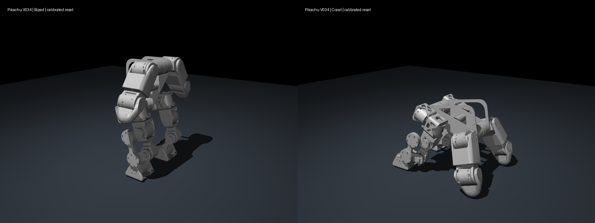
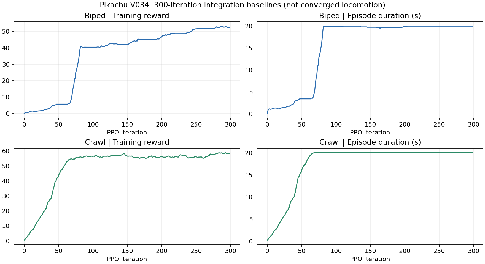
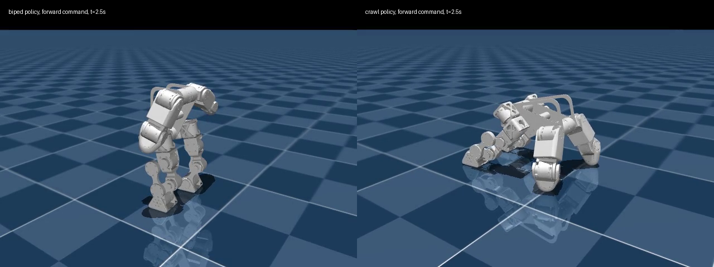

# Pikachu v034：双足与四足基础训练

[返回目录导航](../README.md)

**后续运行：** 已按要求启动双足、四足各续训至总计 5000 轮，每 500 轮保存模型和对应视频。实时进度与运行说明见 [5000 轮续训](continuation_5000.md)。下文保留的是最初 300 轮基线结果，不代表续训后的性能。

已完成 v034 独立资产导入、双足/四足任务注册、各 300 轮 PPO、checkpoint/ONNX 导出，以及固定命令评估。**这是接入和稳定支撑基线，尚未训练出合格的行走或爬行策略。** 两种策略虽然回合长度达到 20 秒，但固定命令测试的实际推进速度明显低于目标，不能只凭训练奖励判断步态成功。

## 任务与资产

| 用途 | 任务 ID | 日志目录 |
| --- | --- | --- |
| 双足站立/低速行走 | `Mjlab-Velocity-Flat-Pikachu-V034-Biped` | `logs/rsl_rl/pikachu_v034/biped/` |
| 四足支撑/爬行 | `Mjlab-Velocity-Flat-Pikachu-V034-Crawl` | `logs/rsl_rl/pikachu_v034/crawl/` |

模型来源：`/home/finnox/Pikachu/PikachuRobot/pikachu_urdf/pikachu_v034`。导入快照位于 `src/mjlab/asset_zoo/robots/pikachu/xmls/pikachu_v034/`，未修改源目录。`source_manifest.json` 记录原始文件 SHA-256；归档目录中的 `provenance/source_snapshot/` 和 `provenance/source_hashes.json` 保存交付时的 v034 代码及资产哈希，补充训练器 git diff 无法记录未跟踪文件的限制。

- 整机质量 **8.890779 kg**，22 个铰接关节，18 个驱动、4 个被动，另有浮动基座。训练状态 `nq=29`、`nv=28`；实体加入执行器后 `nu=18`。
- 保留 v034 的原始惯性、轴向、限位、两侧四杆闭合约束。`knee_up` 的范围为 `[-π/2, 70°]`，没有套用 v033 的旧限位。被动 `knee/knee_mid` 不添加执行器，不参与驱动关节姿态罚。
- 零位鞋底对应的站高 **0.237914 m**。足底约 **81 × 83 mm**，每足 5 条胶囊在网格包围盒内，胶囊底面与鞋底一致。
- 双足初态双臂 roll 为左 −53°、右 +53°，腿部为零位；实际 reset 留 3 mm 落地间隙。
- 四足使用重新求解的 v034 姿态：躯干 pitch **1.4 rad**，基座高度 **0.227776 m**（reset 另加 3 mm）；足点约 `x=-0.09, y=±0.10`，前支撑点约 `x=0.24, y=±0.13`。四杆闭合残差约 `3.1e-12 m`；质心投影位于四点支撑区域内。完整角度见资产目录 `crawl_pose.json`。
- 四足前支撑用肘部末端的半径 16 mm 球体近似，并加入躯干碰撞盒；双足只启用脚底碰撞。当前为平地简化接触模型，未验证全身自碰撞或实机接触。
- 电机额定扭矩来自 v034 `robot_config.json`：4310 为 12.5 N·m，3507 为 3 N·m。PD 增益和转子惯量采用现有 DM 电机估计，尚未完成 v034 实机标定。



## 训练与评估设置

两种任务均使用 128 个并行环境、每轮 24 步、300 轮，共 **921,600 个环境步/任务**。物理步长 0.0025 s，控制频率 50 Hz；网络为 `(256,128,64)`；无旧版镜像增强，动作裁剪为 ±3。使用本地 TensorBoard，开启 NaN guard。双足训练 seed=42，四足训练 seed=42。最后保存点为 `model_299.pt`，对应完成 300 轮，编号从 0 开始。

初始四足训练曾因会话中断在第 5 轮停止，保留在 `2026-10-23_13-00-36_baseline_20261023_130028/`；**本报告不使用该中断运行**。正式四足结果来自后续完整的 300 轮运行。

正式评估每个任务测试站立、前进、后退、侧移、转向，每档 **16 个环境 × 10 秒**，seed=42。标称评估关闭摩擦、质心和编码器偏置随机化；随机化评估保留训练的这些随机化。两者均关闭观测噪声，固定 reset 朝向，未测试推扰或崎岖地形。标称条件的多个环境不是独立随机场景。

评估在 reset 前固定命令范围并核对实际命令，记录速度 MAE、无跌倒环境比例、首次跌倒时间和支撑数；计算位移时排除发生自动重置的那一步，避免把重置跳变算成运动。零动作对照是真实自由基座 + PD 默认姿态，没有冻结关节或基座平衡外力。

详细结果见 [evaluation_report.md](evaluation_report.md)，原始 JSON 保存在 `data/` 中。[运行清单](../data/runs.json)给出精确 checkpoint 和 ONNX 路径。



短视频均为固定前进命令下的 5 秒、单环境标称回放，与正式 10 秒统计单独保存：

- [双足前进命令回放](../media/clips/biped_forward.mp4)：目标 0.20 m/s。
- [四足前进命令回放](../media/clips/crawl_forward.mp4)：目标 0.10 m/s。



## 复现命令

以下命令均在 `pikachu_playground/mjlab/` 执行，使用已经验证过的 `.venv`。

列出任务：

```bash
.venv/bin/python -m mjlab.scripts.list_envs --keyword V034
```

一次性重新运行两种基础训练及零动作/标称/随机化评估：

```bash
MUJOCO_GL=egl .venv/bin/python scripts/run_v034_baselines.py \
  --mode both --iterations 300 --num-envs 128 --eval-envs 16 --seconds 10
```

该入口顺序运行任务，记录准确 checkpoint，保存代码快照、模型参数、训练日志和评估 JSON。`--mode biped` 或 `--mode crawl` 可单独运行；`--iterations 5000` 可运行更长的从零训练，但不能据此预先保证收敛。

评估已保存模型（将 checkpoint 替换为 `data/runs.json` 中的完整路径）：

```bash
MUJOCO_GL=egl .venv/bin/python scripts/eval_v034.py \
  --mode biped --checkpoint /path/to/model_299.pt \
  --num-envs 16 --seconds 10 --output /tmp/v034_biped_eval.json
```

四足改为 `--mode crawl`；加 `--randomized` 保留训练域随机化；不传 `--checkpoint` 即为零动作对照。录制前进视频：

```bash
MUJOCO_GL=egl .venv/bin/python scripts/eval_v034.py \
  --mode crawl --checkpoint /path/to/model_299.pt --clips forward \
  --num-envs 1 --seconds 5 --output /tmp/v034_crawl_video_eval.json \
  --video /tmp/v034_crawl_forward.mp4
```

从本次双足权重追加训练 4700 轮：

```bash
MUJOCO_GL=egl .venv/bin/python -m mjlab.scripts.train \
  Mjlab-Velocity-Flat-Pikachu-V034-Biped \
  --env.scene.num-envs 128 --agent.resume True \
  --agent.load-run 2026-10-23_12-56-19_baseline_20261023 \
  --agent.load-checkpoint model_299.pt --agent.max-iterations 4700 \
  --agent.run-name baseline_continue --enable-nan-guard True
```

四足续训替换任务后缀为 `Crawl`，`--agent.load-run` 替换为 `2026-10-23_13-04-42_baseline_20261023_130436`。`max-iterations` 是本次追加轮数。

交互查看训练策略：

```bash
.venv/bin/python -m mjlab.scripts.play Mjlab-Velocity-Flat-Pikachu-V034-Crawl \
  --checkpoint-file /path/to/model_299.pt --num-envs 1 --viewer viser
```

重建当前资产快照和四足姿态：

```bash
.venv/bin/python scripts/build_v034_train_xml.py
.venv/bin/python scripts/calibrate_v034_crawl.py
.venv/bin/python -m pytest tests/test_pikachu_v034.py -q
```

如需导入以后修改过的 CAD，在 builder 命令后加 `--source /home/finnox/Pikachu/PikachuRobot/pikachu_urdf/pikachu_v034`，然后重新校准、检查和训练；不要默认把旧 checkpoint 当成新几何的有效策略。

## 检查与后续训练重点

7 项测试通过，覆盖源模型参数保留、两种任务注册/执行器/reset、四足闭环/接触几何、源文件哈希、接触通道顺序以及跨 90° pitch 的水平朝向。新增代码通过 Ruff，两个 ONNX 通过结构检查；GPU PPO、策略加载、全部评估和两段视频均实际执行。

本次速度跟踪未达标。下一阶段应针对“静止支撑局部最优”做步态课程和奖励实验，逐步检查抬脚、交替支撑与净推进，而不是把零跌倒当作运动任务通过。双足和四足应分别调参；当前前支撑近似、PD 参数和未开启的自碰撞也需要进一步校验后再讨论实机迁移。
