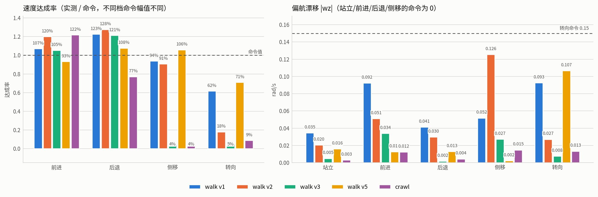
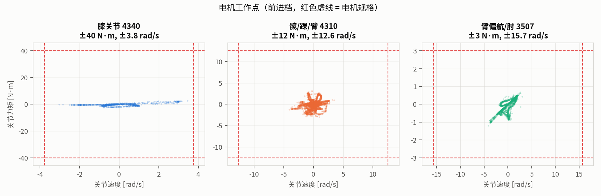

# Pikachu v035 直驱膝关节 —— 直立/四足速度跟踪训练与评估

> 归档日期：2026-10-28 ｜ 代码根目录：`pikachu_playground/mjlab` ｜ 资产根目录：`pikachu_urdf/pikachu_v035`
>
> 所有结论都来自**确定性评估**（策略取均值动作、无探索噪声、16 环境 × 8 s、固定命令、seed 42）。
> 训练期的 TensorBoard 遥测是在带噪声的策略上测的，不能直接当作行为证据。

---

## 1. 本次交付内容

| 环节 | 产出 | 位置 |
| --- | --- | --- |
| v035 配置 | 关节限位、电机型号、CAD 零位 | [config/robot_config.json](../../../pikachu_urdf/pikachu_v035/config/robot_config.json) |
| 左右惯量镜像 | 以左腿为基准回填右腿，残差报告 | [config/symmetry_report.json](../../../pikachu_urdf/pikachu_v035/config/symmetry_report.json) |
| URDF | 18 个全直驱 revolute 关节 | [urdf/pikachu_v035.urdf](../../../pikachu_urdf/pikachu_v035/urdf/pikachu_v035.urdf) |
| MJCF | easymjcf 转换结果 | [mjcf/pikachu_v035.xml](../../../pikachu_urdf/pikachu_v035/mjcf/pikachu_v035.xml) |
| mjlab 适配 | v035 资产接入 + 任务族（E1 / Walk / V2 / V3 / V4 / V5 / Crawl） | `src/mjlab/tasks/velocity/config/pikachu_v035_*` |
| 训练 | E1 站桩 3000 轮、walk 5000 轮 + 三轮偏航修正各 1500 轮、crawl 3000 轮 | `logs/rsl_rl/pikachu_v035/` |
| 评估 | 六个策略 35 组确定性评估 + 回放视频 | [data/](data/) · [media/clips/](media/clips/) |
| 交付页 | 自包含 HTML 报告（图表 + 视频内嵌） | [reports/index.html](reports/index.html) |

交付页是把图片和视频以 base64 内联进同一个 HTML（约 5.9 MB），由 `report_template.html`
加 `media/` 生成，产物落在本目录的 [reports/index.html](reports/index.html)。
模板改过之后重新构建：

```bash
cd mjlab && python3 doc/pikachu_v035_20261028/build_report.py [输出路径]
```

（不带参数就写回 `reports/index.html`。）

**不要直接打开 `report_template.html`**：它的 `src` 是 `@@IMG:<…>@@` / `@@VID:<…>@@`
占位符，浏览器无法解析，所以图片和视频全是坏的；只有构建后才会替换成真实资源。

---

## 2. 模型与资产

### 2.1 v035 相对上一版的变化

v035 取消了膝关节的四杆闭链，改成**直驱铰链**：仿真里只有一个 `knee` 自由度，
不再有 `knee_up / knee_mid / knee` 三关节耦合，传动比恒为 1:1，也没有并联机构的零位偏置。
代价是膝关节要直接承受全部力矩，因此这一代把膝关节换成 **4340**。

### 2.2 关节与电机

| 关节 | 电机 | 限位（左侧值，rad / deg） | 右腿轴反向 |
| --- | --- | --- | --- |
| hip_pitch | 4310 | −2.440 … +2.440 / −139.8 … +139.8 | 否 |
| hip_roll | 4310 | −0.260 … +0.260 / −14.9 … +14.9 | 否 |
| hip_yaw | 4310 | −0.260 … +0.260 / −14.9 … +14.9 | 否 |
| knee | **4340** | −0.524 … +1.571 / −30.0 … +90.0 | 是 |
| ankle | 4310 | −0.790 … +1.050 / −45.3 … +60.2 | 是 |
| arm_pitch | 4310 | ±1.571 / ±90.0 | 否 |
| arm_roll | 4310 | ±1.571 / ±90.0 | 否 |
| arm_yaw | 3507 | ±1.571 / ±90.0 | 否 |
| elbow | 3507 | ±1.571 / ±90.0 | 否 |

「右腿轴反向」= 右关节轴指向与左侧相反，因此右侧限位是左侧的 `[-upper, -lower]`。

注意 **`arm_roll` 的轴向和上一版相反**：v035 是 `(-1, 0, 0)`（左右同轴），v033/v034 是
`(+1, 0, 0)`。限位对称到看不出差别，但默认位姿与任何绝对角度窗口的符号都会整体反过来
——按 v034 的习惯写 L−53°/R+53° 在 v035 上是**上臂抬起 53°**。当前默认位姿是
L+53°/R−53°（下垂），详见 §7 第 3 条。

电机规格（来自 `robot_config.json`）：

| 型号 | 额定力矩 | 峰值/限幅力矩 | 速度上限 | 用途 |
| --- | --- | --- | --- | --- |
| 4340 | 12 N·m | 40 N·m | 3.77 rad/s（36 rpm） | 膝 |
| 4310 | 12.5 N·m | 12.5 N·m | 12.57 rad/s | 髋三轴、踝、臂 pitch/roll |
| 3507 | 3 N·m | 3 N·m | 15.71 rad/s | 臂 yaw、肘 |

**4340 的关键指标是转速而不是力矩**：3.77 rad/s 只有 4310 的 30%。
后面第 5 节的实测把这条放大了——膝关节的力矩始终只有 2–3 N·m（相对 40 N·m
几乎空载），而角速度在四足档顶到 3.5 rad/s、在直立行走档甚至冲到 8 rad/s。
这是本次评估最重要的工程结论，详见第 5 节。

### 2.3 CAD 零位与站高

URDF 里腿的 joint origin 不是完全直立，而是按 CAD 初始姿态留了偏置：
相对完全伸直的腿，`hip_pitch = 20°`、`knee = 20°`、`ankle = 10°`
（对应 rpy = −0.34907 / +0.52360 / −0.17453）。
mjlab 的站立高度 `STAND_HEIGHT = 0.22957707433403704 m` 由这个姿态正解得到，
不沿用任何旧版常数。

### 2.4 左右惯量镜像校验

URDF 导出时右腿/右臂的惯量是另算的，和左腿不是严格镜像。做法：

1. 以**左侧为基准**，按 `y → −y` 镜像质心，按轴变换镜像惯量分量；
2. 非对角项 `ixy / ixz / iyz` 各自有一个 ±1 的符号规则，取决于该关节轴在镜像下的取向。
   逐关节的符号表写在 `symmetry_report.json` 的 `mirror_sign_offdiagonal` 里
   （例如 `hip_roll` 三个都是 +1，而 `knee` 是 −1 / +1 / +1）；
3. 用镜像后的值覆盖右侧，再重新比对。

结果（`symmetry_report.json`）：

| 部位 | 镜像前：右侧相对「镜像后的左」的最大偏差 | 覆盖后残差 |
| --- | --- | --- |
| 质量 | 0 | 0 |
| 质心（臂） | 1.66 mm | 4.54e-14 m |
| 质心（髋/膝/踝） | 0.01 … 0.31 mm | 4.54e-14 m |
| 惯量 | 对角项本身一致；非对角项如 `knee.iyz` 有 3e-5 的偏差 | 0 |

也就是说：**质量两侧本来就相同，惯量对角项也一致，真正不一致的是质心偏移
（手臂最大 1.66 mm）和个别非对角惯量项**。数值不大，但直驱膝对腿部惯量比
很敏感，所以仍然按左侧统一覆盖。

**注意**：这里的一致性只说明「右 = 镜像(左)」，
不说明「左本身的惯量参数是对的」——后者要靠 CAD 质量属性，本次没有独立复核。

### 2.5 URDF → MJCF

用 easymjcf 转换（只传 URDF 一个参数，输出目录须事先存在）：

```bash
cd pikachu_urdf/pikachu_v035
uv run easymjcf urdf/pikachu_v035.urdf
```

转换后校验：**19 个 link、18 个 joint、总质量 8.2299 kg、nq = 25、nv = 24、equality 约束数 = 0**。
`equality = 0` 是这一代的关键——四杆闭链去掉后不再需要任何等式约束。

`scripts/build_v035_train_xml.py` 再把 easymjcf 产物变成训练资产（加 floating base、IMU
site、sensors、脚底胶囊和 `stand` keyframe）。**默认位姿的 `arm_roll` 就写在这个脚本里**，
改手臂默认姿态要同时改脚本和 `pikachu_v035_constants.BIPED_KEYFRAME`，否则重跑脚本会把
keyframe 覆盖回旧值。

---

## 3. 训练设置

各任务共用同一套机体资产与观测，区别只在奖励口径和命令分布。

| 任务 | 定位 | 命令范围 (vx, vy, wz) | 轮数 | 并行环境 |
| --- | --- | --- | --- | --- |
| `V035-Biped-E1` | 直立**站桩基线**（对照组） | ±0.20 / ±0.06 / ±0.15 | 3000 | 2048 |
| `V035-Biped-Walk` | 直立**行走** | −0.30…+0.40 / ±0.20 / ±0.25，1500 轮后扩到 −0.40…+0.55 / ±0.30 / ±0.35 | 5000 | 2048 |
| `V035-Biped-Walk-V2` | 偏航修正尝试 1：收紧 std（**退步**） | 同 walk | +1500（热启动） | 2048 |
| `V035-Biped-Walk-V3` | 偏航修正尝试 2：非饱和 Huber 代价（**退步**） | 同 walk | +1500（热启动） | 2048 |
| `V035-Biped-Walk-V4` | 膝关节换 DC 电机模型（验证可部署性） | 同 walk | 未训 | 2048 |
| `V035-Biped-Walk-V5` | 偏航修正尝试 3：角速度权重 2.0→6.0（**交付策略**） | 同 walk | +1500（热启动） | 2048 |
| `V035-Crawl` | **四足**爬行 | −0.15…+0.20 / ±0.04 / ±0.15 | 3000 | 2048 |

任务之间的差异（这是本次调参的主要工作量）：

- **E1 之所以走不起来不是一个 bug**：它带 `standing_*` 奖励族、25% 的零命令样本，
  推扰只施加给「已经在移动」的机器人，`init_std = 0.25` 探索很小；
  再加上跟踪奖励的 `std = sqrt(0.25) = 0.5` 远宽于 ±0.2 的命令，
  站桩就能拿到 0.92 的跟踪分。这组设置的下场必然是站桩，保留它就是为了**当对照**。
- **walk 把「站着很赚」这条路堵死**：去掉 standing 奖励族、零命令样本降到 10%、
  推扰对全员施加、`track_linear_velocity` 权重提到 5 且换成 Huber、
  `directional_progress +3.0`、`action_rate −0.05`、`short_step_air_time −1.0`，
  `init_std` 提到 0.8、`entropy_coef 0.005`。
- **walk v2 只改三处**（其余全部继承 walk）：`track_angular_velocity`
  std 0.707 → 0.35、权重 2.0 → 2.5；`track_linear_velocity` std 0.50 → 0.30；
  `body_ang_vel` 权重 −0.05 → −0.12。见第 4.3 节。

奖励权重预算的经验（来自 v034 的教训，本次沿用）：单项罚的**单步**量级不要超过
进度奖励的三成。v034 曾经把 `straight_base_roll_rate` 设到 −0.60（单步罚 4.8，
而进度奖励只有 3.5），70 轮就把一个会走的策略打回站桩。

---

## 4. 结果

### 4.1 E1：站桩基线（3000 轮，`model_2999`）

| 档位 | 命令 | 实测均值 | 速度 MAE | 摔倒 | 平均支撑数 |
| --- | --- | --- | --- | --- | --- |
| 站立 | (0, 0, 0) | (−0.001, 0.000, 0.003) | 0.001 / 0.001 / 0.008 | 0 | 2.00 |
| 前进 | (0.20, 0, 0) | (−0.001, −0.001, 0.004) | **0.201** | 0 | 2.00 |
| 后退 | (−0.12, 0, 0) | (−0.001, 0.000, 0.003) | 0.119 | 0 | 2.00 |
| 侧移 | (0, 0.06, 0) | (−0.001, 0.000, 0.001) | 0.001 / 0.060 | 0 | 2.00 |
| 转向 | (0, 0, 0.15) | (−0.001, −0.001, 0.006) | 0.002 / 0.001 / 0.144 | 0 | 2.00 |

**读法**：五个档位的实测速度几乎完全相同（±0.001），支撑数恒为 2.00——
策略在所有命令下都只是站着。这是预期的对照组结果，不是失败。

### 4.2 walk v1：能走的直立步态（5000 轮，`model_4999`）

| 档位 | 命令 | 实测均值 | 速度 MAE | 摔倒 | 支撑数 |
| --- | --- | --- | --- | --- | --- |
| 站立 | (0, 0, 0) | (−0.007, 0.000, **+0.035**) | 0.015 / 0.017 / 0.089 | 0 | 1.15 |
| 前进 | (0.20, 0, 0) | (**+0.214**, −0.010, +0.092) | 0.015 / 0.028 / 0.221 | 0 | 1.10 |
| 后退 | (−0.12, 0, 0) | (**−0.147**, +0.015, +0.041) | 0.028 / 0.024 / 0.119 | 0 | 1.10 |
| 侧移 | (0, 0.06, 0) | (−0.015, **+0.056**, +0.052) | 0.016 / 0.027 / 0.094 | 0 | 1.13 |
| 转向 | (0, 0, 0.15) | (−0.004, −0.002, **+0.093**) | 0.014 / 0.015 / 0.112 | 0 | 1.17 |

前四档的线速度跟踪都在 7% 误差内（前进实测 0.214 vs 命令 0.20），
支撑数 1.1 说明确实是单腿支撑行走而不是挪步。

**两个明显缺陷**：

1. **前进时偏航漂移**：wz 均值 +0.092 rad/s 而命令是 0，8 秒会拐出约 42°；
   站立档也有 +0.035 rad/s 的缓慢自转。
2. **转向只做到 62%**：命令 0.15 rad/s 实测 0.093，MAE 0.112。

这两项是同一类问题，但不是「std 太宽」这么简单。指数型跟踪奖励的回复力**正比于误差本身**
（∂/∂e exp(−(e/s)²) = −2e/s²·exp(−(e/s)²)），误差越小坡度越平。
v035 walk 的角速度 std 已经收到 0.40（基类默认 0.707），0.09 rad/s 的漂移对应
`exp(-(0.09/0.40)²) = 0.95`——几乎满分，而修掉它必须改步态，代价不小，于是策略选择忽略。

### 4.3 walk v2：收紧 std 的尝试 —— **退步**

v2 从 v1 末轮热启动，只动三处：角速度跟踪 std 0.40→0.35、权重 2.0→2.5；
线速度 std 0.20→0.30（这一项其实是**放宽**）；`body_ang_vel` −0.05→−0.12。

| 档位 | v1 实测 wz | v2 实测 wz | v1 MAE wz | v2 MAE wz | 支撑数 v1→v2 |
| --- | --- | --- | --- | --- | --- |
| 站立 | +0.035 | **+0.020** | 0.089 | **0.031** | 1.15 → 1.96 |
| 前进 | +0.092 | **+0.051** | 0.221 | **0.345** | 1.10 → 1.08 |
| 后退 | +0.041 | **−0.030** | 0.119 | **0.093** | 1.10 → 1.13 |
| 侧移 | +0.052 | **+0.126** | 0.094 | **0.156** | 1.13 → 1.15 |
| 转向 | +0.093 | **+0.027** | 0.112 | **0.147** | 1.17 → 1.95 |

**净结果是退步**（v2 = `model_6498`）：

1. **转向塌到 18%**：命令 0.15 只做出 0.027，比 v1 的 0.093 差三倍多；转向档支撑数 1.95
   ——双足着地，策略干脆站住了。站立档同样退化到 1.96，v1 的「原地挪步」微动没了。
2. **侧移偏航漂移翻倍**：0.052 → 0.126，均值与 MAE 同时变差。
3. **前进开始超速**：0.240 vs 命令 0.20（MAE 0.015→0.040）；同时 wz 的 MAE 涨到 0.345——
   均值漂移小了，但**瞬时偏航振荡剧烈**，是「均值好看、行为更差」的典型。

三处同时改导致归因不干净，但现象指向同一结论：**非纵向命令下策略学会了「站着不动」**。

因此 **v2 不作为交付策略**。下一轮（v3）把这三处全部回退，只补一个非饱和的偏航
Huber 代价，让误差小的地方也保持恒定梯度。


### 4.4 walk v3：补非饱和偏航 Huber —— **退步，但暴露了机制**

v3 把 v2 的三处改动全部回退，只加一项 `angular_velocity_huber`
（`angular_velocity_huber_error`，权重 −0.30、`delta = 0.25`），从 v1 末轮
热启动跑 1500 轮（`model_6498`）。

| 档位 | v1 实测 wz | v3 实测 wz | v1 MAE wz | v3 MAE wz | 支撑数 v1→v3 |
| --- | --- | --- | --- | --- | --- |
| 站立 | +0.035 | **−0.005** | 0.089 | **0.014** | 1.15 → 1.98 |
| 前进 0.20 | +0.092 | **+0.034** | 0.221 | **0.085** | 1.10 → 1.10 |
| 后退 −0.12 | +0.041 | **−0.002** | 0.119 | **0.074** | 1.10 → 1.12 |
| 侧移 0.06 | +0.052 | 0.027（实测 vy **+0.002**） | 0.094 | 0.035 | 1.13 → 1.96 |
| 转向 0.15 | +0.093 | 0.008（实测 wz **+0.008**） | 0.112 | 0.149 | 1.17 → 1.98 |

1. **前进漂移真的被治好了**：+0.092 → +0.034 rad/s，MAE 0.221 → 0.085，两项一起降；
   后退档同样（+0.041 → −0.002）。
2. **代价是转向和侧移一起停摆**：转向只做出命令的 5%、侧移 4%，两档支撑数都到
   1.96–1.98（双足着地 = 站住）。前进档支撑数仍是 1.10，会走。
3. **塌陷是渐进的**，中间 checkpoint 留下了轨迹：

| checkpoint | 前进 vx / wz | 转向达成率 | 侧移达成率 | 转向档支撑数 |
| --- | --- | --- | --- | --- |
| `model_5250`（+250 轮） | 0.220 / +0.090 | **31%** | **106%** | 1.23 |
| `model_6000`（+1000 轮） | 0.206 / −0.039 | 1% | 5% | 1.97 |
| `model_6498`（+1500 轮） | 0.211 / +0.034 | 5% | 4% | 1.98 |

**机制**：同一训练窗口（5200 → 6498 轮）里 tensorboard 上 31 个奖励项
**全部平台化**（均值变化均 < 0.01），而确定性转向能力从 31% 掉到 5%——
训练分数一路"健康"，行为在退化。量级上的线索：

| 奖励项 | 权重 | 训练中实际贡献 |
| --- | --- | --- |
| `track_linear_velocity` | 5.0 | **3.72** |
| `track_angular_velocity` | 2.0 | **0.40** |

角速度跟踪的份量只有线速度的十分之一，于是「把直线走好」的边际收益远大于
「学会转向」；而站桩时 wz ≈ 0，在 yaw 命令下仍能拿 `exp(−(0.35/0.4)²) = 0.47`
的角速度奖励。**v2 和 v3 都在加重「跟踪不上」的代价，方向是反的**——只会让
策略更快地放弃转向。下一轮改成抬高正确行为的收益（`track_angular_velocity`
权重 2.0 → 6.0）。

### 4.5 walk v5：抬高角速度跟踪权重

只改一处：`track_angular_velocity` 权重 **2.0 → 6.0**，与线速度（5.0）同量级。
其余（奖励、命令分布、执行器、观测、`init_std 0.8` / `entropy 0.005`）全部沿用 v1，
从 v1 末轮热启动跑 1500 轮（`model_6498`）。

| 档位 | 命令 | v1 实测 | v5 实测 | v1 wz / MAE | v5 wz / MAE | 支撑数 v1→v5 |
| --- | --- | --- | --- | --- | --- | --- |
| 站立 | (0,0,0) | 0.000 | 0.003 | +0.035 / 0.089 | **+0.016 / 0.058** | 1.15 → 1.27 |
| 前进 | (0.20,0,0) | +0.214 | +0.187 | +0.092 / 0.221 | **−0.013 / 0.071** | 1.10 → 1.16 |
| 后退 | (−0.12,0,0) | −0.147 | **−0.129** | +0.041 / 0.119 | **−0.013 / 0.035** | 1.10 → 1.20 |
| 侧移 | (0,0.06,0) | +0.056 | **+0.064** | +0.052 / 0.094 | **−0.002 / 0.057** | 1.13 → 1.24 |
| 转向 | (0,0,0.15) | +0.093 | **+0.107** | +0.093 / 0.112 | **+0.107 / 0.087** | 1.17 → 1.25 |

1. **转向 62% → 71%，MAE 0.112 → 0.087**，而且 wz 终于是朝着命令方向走的
   （+0.107 vs 命令 +0.15），不是像 v2/v3 那样退向 0。
2. **侧移 93% → 106%，前进/后退/侧移的偏航漂移全档降到 0.013 以内。**
   上一轮 Huber 是靠「压住行为」把漂移压下去的，v5 是把行为做对之后漂移自然消失。
3. **代价：前进从超速 7% 变成欠速 7%**（0.214 → 0.187，MAE 都是 0.015）；
   后退反而更准（v1 超 22% → v5 超 7.6%）。

速度包线（前进档，全档 0 摔倒，支撑数 1.10–1.16）：

| 命令 m/s | 实测 vx | 达成率 | MAE vx | wz 漂移 |
| --- | --- | --- | --- | --- |
| 0.10 | +0.104 | 104% | 0.009 | −0.039 |
| 0.15 | +0.143 | 96% | 0.010 | −0.016 |
| 0.20 | +0.187 | 93% | 0.015 | −0.013 |
| 0.40 | +0.371 | 93% | 0.029 | +0.021 |

**v5 是交付策略。** 三档微调放在一起看，结论很干净：v2 和 v3 都在加重「跟踪不上」的
代价，v5 是把「跟踪上」的收益抬到与线速度同量级。同一个站桩解，在前两次的奖励下
「罚得少、拿得多」，在 v5 下「罚得多、拿得少」——策略于是真的去转向了。

### 4.6 crawl：四足前进（3000 轮，`model_2999`）

| 档位 | 命令 | 实测均值 | 速度 MAE | 摔倒 | 支撑数 |
| --- | --- | --- | --- | --- | --- |
| 站立 | (0, 0, 0) | (−0.001, 0.000, 0.003) | 0.002 / 0.001 / 0.011 | 0 | 3.96 |
| 前进 | (0.10, 0, 0) | (**+0.122**, −0.005, −0.012) | 0.022 / 0.014 / 0.034 | 0 | 2.44 |
| 后退 | (−0.06, 0, 0) | (**−0.046**, −0.001, 0.004) | 0.015 / 0.008 / 0.033 | 0 | 3.79 |
| 侧移 | (0, 0.04, 0) | (−0.001, **+0.002**, 0.015) | 0.003 / **0.038** / 0.020 | 0 | 3.98 |
| 转向 | (0, 0, 0.15) | (−0.003, 0.001, **+0.013**) | 0.004 / 0.002 / **0.138** | 0 | 3.95 |

前进档 0.122 / 命令 0.10（+22%），速度包线实测
0.10 / 0.15 / 0.20 → 0.122 / 0.168 / 0.210 m/s，MAE 0.013–0.019，全档 0 摔倒。
站立时支撑数 3.96（四足着地），前进时降到 2.44——四足步态的抬腿相很清楚。

**侧移与转向失败（实测 0.002 / 0.013，接近 0）**，根因是奖励结构而不是调参。
查代码后可以定位到两条（`pikachu_v035_crawl/mdp.py`）：

1. **`gait_contacts_smooth_120`（权重 +1.8）是无条件项**。它奖励「实际接触相 = 参考接触相」，
   而参考相在静止时正好是「全部支撑」——于是**站着不动就能拿满这 +1.8**。
   侧移/转向命令很小（0.04 m/s、0.15 rad/s），一旦真动起来接触相就被打乱，反而掉分。
2. **`directional_progress`（权重 +3.0）只看纵向**：`command[:, 0]`。
   前进/后退有这条强拉力，侧移（vy）和转向（wz）**没有任何对应的「进度」项**，
   只剩指数跟踪项那点微弱梯度，压不过上面的 +1.8 站桩补贴。

（`forward_*` 系列——`directional_smooth_gait_mismatch`、`forward_velocity_shortfall`、
`directional_sole_cost`——都乘了 `forward_weight`，命令不是纵向时**输出为 0**，
不构成对侧移/转向的对抗。这一条我一开始判断错了，核对实现后纠正。）

下一版改法很明确：把 `gait_contacts_smooth` 改成按实际运动门控，
并补 vy / wz 的进度项（把 `directional_progress` 扩成三轴）。
这是结构性改动，不是本次微调能解决的范围。

### 4.7 横向对比

| 指标 | walk v1 | walk v2 | walk v3 | **walk v5** | crawl |
| --- | --- | --- | --- | --- | --- |
| 前进实测 / 命令 (m/s) | +0.214 / 0.20 | +0.240 / 0.20 | +0.211 / 0.20 | **+0.187 / 0.20** | +0.122 / 0.10 |
| 后退实测 / 命令 (m/s) | −0.147 / −0.12 | −0.153 / −0.12 | −0.145 / −0.12 | **−0.129 / −0.12** | −0.046 / −0.06 |
| 侧移实测 / 命令 (m/s) | +0.056 / 0.06 | +0.054 / 0.06 | +0.002 / 0.06 | **+0.064 / 0.06** | +0.002 / 0.04 |
| 转向实测 / 命令 (rad/s) | +0.093 / 0.15 | +0.027 / 0.15 | +0.008 / 0.15 | **+0.107 / 0.15** | +0.013 / 0.15 |
| 站立 wz (rad/s) | +0.035 | +0.020 | −0.005 | **+0.016** | +0.003 |
| 前进 wz 漂移 (rad/s) | +0.092 | +0.051 | +0.034 | **−0.013** | −0.012 |
| 前进 MAE vx | 0.015 | 0.040 | 0.011 | 0.015 | 0.022 |
| 转向 MAE wz | 0.112 | 0.147 | 0.149 | **0.087** | 0.138 |
| 平均支撑数 | 1.13 | 1.45 | 1.63 | 1.22 | 3.62 |
| 摔倒次数（5 档合计） | 0 | 0 | 0 | **0** | 0 |



E1 站桩基线不进这张图：它在四档速度上的实测都在 0 附近，四根柱全是 0。
这样做也把系列数压到 5 个——分类色板只有 5 个色相能同时过色盲与常规视觉的分辨门，
硬凑第 6 个会掉到 ΔE 11.7（低于 15 的下限）。

---

## 5. 电机工作点与工程结论



按评估数据逐关节统计的利用率（`|v|max` / 速度上限，`|τ|max` / 力矩上限）：

| 任务 | 关节 | 峰值角速度 | 峰值力矩 | 结论 |
| --- | --- | --- | --- | --- |
| crawl 前进 | 膝 4340 | **3.46 rad/s（92%）** | 2.55 N·m（6%） | 贴着额定转速跑，力矩几乎不用 |
| crawl 前进 | 髋 pitch 4310 | 3.77 rad/s（30%） | 3.10 N·m（25%） | 余量充足 |
| crawl 前进 | 踝 4310 | 2.74 rad/s（22%） | 1.62 N·m（13%） | 余量充足 |
| walk 前进 @0.2 | 膝 4340 | **8.54 rad/s（226%）** | 2.27 N·m（6%） | 超额定转速 2.3 倍 |
| crawl 前进 @0.15 | 膝 4340 | 3.90 rad/s（103%） | 2.88 N·m（7%） | 刚过额定 |
| walk 前进 @0.4 | 膝 4340 | **12.05 rad/s（320%）** | 5.48 N·m（14%） | 超额定转速 3.2 倍 |
| walk 前进 @0.2 | 髋 pitch 4310 | 3.69 rad/s（29%） | 4.99 N·m（40%） | 髋是全程力矩最紧的关节 |
| walk 前进 @0.2 | 踝 4310 | 5.15 rad/s（41%） | 2.00 N·m（16%） | 余量充足 |

**两条硬结论：**

1. **这一代的膝是「速度受限」而不是「力矩受限」**。三档膝关节力矩都只有
   2.0–5.5 N·m，相对 40 N·m 峰值（甚至 12 N·m 额定）几乎空载；真正的瓶颈是转速。
   选 4340 是为了承受闭链改直驱后的力矩，但从实际工况看，膝关节更需要的是**转速**。
2. **walk 的步态需要 2.3–3.2 倍额定转速的膝摆动**，这条必须在实物上核实。
   DM 电机的「额定 36 rpm」是连续工作点，空载转速通常更高（一般 1.5–2 倍），
   但仿真里配置的是 `BuiltinPositionActuatorCfg`——**`velocity_limit` 在这个
   执行器类型下不生效**，没有任何扭矩-转速降额，所以仿真允许膝以任何速度摆动、
   且始终可给满 40 N·m。这是当前最大的 sim2real 差距。

   处理办法（下一轮，二选一）：
   - 拿到 4340 的**空载转速**后，把膝关节执行器换成 `DcMotorActuatorCfg`
     （`saturation_effort=40`、`velocity_limit=空载转速`、`effort_limit=12`），
     让物理自己禁止超速，再重训 walk；
   - 或者接受更慢的步态：把命令上限压到 0.1 m/s 量级（crawl 已验证在这个量级
     膝峰值 3.5 rad/s，恰好贴着额定）。

   请注意 crawl 档能跑通，恰恰是因为它的步态慢——膝速 92% 额定，还在能力边界内。

---

## 6. 与 v034 的对比

v034 是**四杆闭链膝**那一代。为了可比，这里只取同命令幅值、同评估协议的结果
（v034 侧为 16 环境 × 12 s，v035 侧为 16 环境 × 8 s，均确定性、seed 42、0 摔倒）。

**直立行走（前进命令 0.4 m/s）**

| 策略 | 实测 vx | MAE vx | wz 漂移 | 说明 |
| --- | --- | --- | --- | --- |
| v034 Biped-Retarget（5000 轮） | 0.389 | 0.028 | **+0.002** | 闭链膝，偏航几乎不动 |
| v034 Biped-Gait（5000 轮） | 0.381 | 0.050 | −0.063 | 偏航同样偏 |
| **v035 Biped-Walk（5000 轮）** | **0.390** | **0.015** | +0.045 | 直驱膝，跟踪更准、偏航略差 |

**四足前进（前进命令 0.15 m/s）**

| 策略 | 实测 vx | MAE vx | 说明 |
| --- | --- | --- | --- |
| v034 Crawl-Knee（3000 轮） | 0.1603 | **0.012** | 闭链膝 |
| **v035 Crawl（3000 轮）** | **0.1682** | 0.019 | 直驱膝，略快、MAE 略大 |

**怎么读这张表**：在各自训练到的轮数下，**v035 的直驱膝没有牺牲跟踪精度**——
直立档 vx MAE 从 0.028 降到 0.015，四足档速度略高、MAE 略大，两者打平。
真正的代际差异不在跟踪精度，而在第 5 节的**转速需求**：闭链四杆把电机的
线性运动换成关节转动，传动比可以放大速度；直驱后膝关节的角速度需求原样落到
4340 的转速指标上，而 4340 只有 36 rpm。这是本次评估里最值得带回去改设计的一条。

> 引用的 v034 数据来自 `logs/rsl_rl/pikachu_v034/experiments/` 下的
> `biped_knee_led_20261027` 与 `crawl_knee_led_20261027` 两份实验归档。
> 更早的 300 轮基线（crawl 前进 0.005 m/s）不作为对照——轮数差一个数量级，比了没意义。

---

## 7. 已知问题与后续路线

1. **crawl 侧移/转向**：奖励模板与命令方向冲突，需把 `forward_*` 系列改成方向条件化。
2. **walk 转向 62% → 71%**（见 4.5）：已定位根因（角速度跟踪的相对权重只有线速度的
   十分之一），v5 修好后仍差 29%。剩余缺口主要是转向档的**瞬时振荡**——均值偏差只有
   0.043，而 MAE 是 0.087。下一步是加航向闭环，或对转向档单独加课，而不是继续调权重。
3. **手臂「举起」已修（2026-10-29）**：根因是 v035 的 `arm_roll` 轴是 `(-1,0,0)`，
   而 v033/v034 是 `(+1,0,0)`。从 v034 抄来的默认位姿 L−53°/R+53° 在 v035 上把上臂
   抬到水平面**上方** 53°（推出来的渲染就是双手举起），而 `ARM_BOUNDS_DEGREES` 的
   (45, 53) 窗口也正好奖励同一姿态，所以六次训练都稳定停在 ±50°。
   改法（`BIPED_KEYFRAME` + MJCF `stand` keyframe + v035 的 `arm_position_window`）：
   默认位姿 L+53°/R−53°（手从肩上 8.4 cm 落到肩下 8.4 cm，仍在 ±90° 限位内，限位不动），
   左右 roll 窗口镜像为 右 (−53,−45) / 左 (45,53)。动作是 `use_default_offset=True` 的
   绝对位姿，所以已交付模型 play 时手臂自动跟着下垂——实测 E1 站立 `arm_roll`
   L+54.9°/R−55.8°、walk 前进 L+56.9°/R−56.7°，8 秒 falls=0。
   **代价（同一 checkpoint、同 seed/16 env/8 s 的 A/B）**：

   | 档位 | 手臂上举（旧） | 手臂下垂（新） |
   | --- | --- | --- |
   | E1 站立 漂移 | 0.0009 m/s | 0.0008 m/s |
   | walk v1 前进 0.20 | 0.214 m/s，wz 漂移 +0.092 | 0.183 m/s，wz 漂移 −0.032 |
   | walk v5 前进 0.20 | 0.187 m/s，wz 漂移 −0.013 | 0.159 m/s，wz 漂移 −0.153 |

   两档都是 falls=0（没摔），但前进掉约 15%、偏航漂移变了量级。原因不是数值 bug：
   `use_default_offset` 让 `arm_roll` 目标整体平移 106°，手臂质量分布与绕 z 转动惯量
   跟着变，而这六个策略是按上举姿态的动力学学的步态。**要恢复原指标必须按新默认位姿
   重训**；同理，想退回上举姿态比较，改的是同一处（`BIPED_KEYFRAME` + MJCF keyframe +
   v035 的 roll 窗口）。它们的**绝对**关节角记录（§4 的 `arm_roll` 包络）与按旧窗口
   算出的 reward 也与新配置不可比。若只希望外展 ±25°，现在窗口方向已与默认位姿一致，
   直接收窄重训即可。
4. **站立姿态用满了髋偏航**：walk 站立档 `hip_yaw` 左 −10.3°、右 +13.7°，
   而限位只有 ±14.9°——已经用掉八成。这是机构设计层面的余量提醒。
5. **4340 转子惯量是估算值**：当前按「4310 的 4 倍」估（没有实测数据）。
   转子惯量直接影响直驱膝关节的高频动态，实测后应重新校核一遍 PD 增益与仿真结果。
6. **鲁棒性未做**：本次全部是**标称评估**（无域随机化）。生产前需要补
   foot friction / base COM / encoder bias / 外力推扰的随机化评估。
7. **两条奖励设计上的方法论，值得在下一版其它任务里复用**：
   - 奖励口径比网络容量重要得多。同样的机器人、同样的观测、同样的 PPO，只是奖励不同，
     一个只会站着、一个能走。
   - **「加重错误的代价」和「抬高正确的收益」不是一回事**。v2（收紧 std + 加惩罚）和
     v3（单项偏航 Huber）都在加重跟踪不上的代价，两次都把转向压到 5% 以下；v5 只把
     正确行为的收益抬到与线速度同量级，一次就把四档全做上去了。改奖励之前先问一句：
     *在当前权重下，策略「什么都不做」能拿多少分？*

---

## 8. 复现命令

```bash
cd pikachu_playground/mjlab

# 训练
uv run train Mjlab-Velocity-Flat-Pikachu-V035-Biped-Walk --env.scene.num-envs 2048 --agent.max-iterations 5000
uv run train Mjlab-Velocity-Flat-Pikachu-V035-Crawl --env.scene.num-envs 2048 --agent.max-iterations 3000

# 热启动微调（注意 --agent.resume 要带值）；V2/V3/V5 都是同一条命令换 task id
uv run train Mjlab-Velocity-Flat-Pikachu-V035-Biped-Walk-V5 \
  --env.scene.num-envs 2048 --agent.max-iterations 1500 \
  --agent.resume True --agent.load-run "2026-10-28_18-33-11_biped_walk_v035" \
  --agent.load-checkpoint "model_4999.pt"

# 确定性评估 + 录像
uv run python scripts/eval_v035.py --mode walk \
  --task Mjlab-Velocity-Flat-Pikachu-V035-Biped-Walk \
  --checkpoint logs/rsl_rl/pikachu_v035/biped_walk/<run>/model_4999.pt \
  --num-envs 16 --seconds 8 \
  --output doc/pikachu_v035_20261028/data/walk/eval.json \
  --video-dir doc/pikachu_v035_20261028/media/clips

# 出图
uv run python scripts/plot_v035_eval.py doc/pikachu_v035_20261028/data/walk
uv run python scripts/plot_v035_training.py logs/rsl_rl/pikachu_v035/biped_walk/<run> \
  --output doc/pikachu_v035_20261028/media/figures/walk_training

# 回放：任务名是位置参数（play 没有 --task），checkpoint 用 --checkpoint-file。
# --viewer velocity-joystick 是带摇杆面板的 viser 网页（localhost:8080，远程需转发端口）。
L=logs/rsl_rl/pikachu_v035

# 交付策略：V5（偏航权重修正后的行走）
uv run play Mjlab-Velocity-Flat-Pikachu-V035-Biped-Walk-V5 \
  --checkpoint-file $L/biped_walk/2026-10-28_23-15-58_walk_v5_angweight/model_6498.pt \
  --viewer velocity-joystick

# 对照：E1 站桩 / 基础行走 / V2 / V3 / Crawl
uv run play Mjlab-Velocity-Flat-Pikachu-V035-Biped-E1 \
  --checkpoint-file $L/biped_e1/2026-10-28_17-22-25_biped_e1_v035/model_2999.pt \
  --viewer velocity-joystick
uv run play Mjlab-Velocity-Flat-Pikachu-V035-Biped-Walk \
  --checkpoint-file $L/biped_walk/2026-10-28_18-33-11_biped_walk_v035/model_4999.pt \
  --viewer velocity-joystick
uv run play Mjlab-Velocity-Flat-Pikachu-V035-Biped-Walk-V2 \
  --checkpoint-file $L/biped_walk/2026-10-28_21-49-32_walk_v2_yawfix/model_6498.pt \
  --viewer velocity-joystick
uv run play Mjlab-Velocity-Flat-Pikachu-V035-Biped-Walk-V3 \
  --checkpoint-file $L/biped_walk/2026-10-28_22-32-43_walk_v3_yawhuber/model_6498.pt \
  --viewer velocity-joystick
uv run play Mjlab-Velocity-Flat-Pikachu-V035-Crawl \
  --checkpoint-file $L/crawl/2026-10-28_18-24-47_crawl_v035/model_2999.pt \
  --viewer velocity-joystick

# 不看策略、只看资产/默认位姿：加 --agent zero（无需 checkpoint）
uv run play Mjlab-Velocity-Flat-Pikachu-V035-Biped-Walk-V5 --agent zero --viewer velocity-joystick
```

批量确定性评估（本文所有数字的来源）用 `scripts/eval_v035.py`；逐条录像走
`media/clips/`，不要用 `play --video` 无头录像（viewer 的 `run()` 不会返回，进程会挂住）。

> 上面的命令和仓库当前配置一致，已包含 2026-10-29 的默认位姿修复
> （`arm_roll` L+53°/R−53°，手臂下垂）。不带 checkpoint 的 `--agent zero`
> 回放看的就是这个默认位姿：手落在肩下 8.4 cm，不会举起。

---

## 9. 文件清单

```text
data/
  biped_e1/  eval.json eval.npz fig1..fig5.png joint_names.json
  walk/      eval.json eval.npz fig1..fig5.png joint_names.json
  walk_v2/   eval.json eval.npz fig1..fig5.png（v2 退步，作为归档）
  walk_v3/   eval.json eval.npz fig1..fig5.png（v3 退步，作为归档）
  walk_v5/   eval.json + eval_forward_0p{10,15,40}.json + fig1..fig5.png（交付策略）
  crawl/     eval.json eval.npz fig1..fig5.png joint_names.json
media/
  clips/     每组 5 段 8 s 回放 mp4 + 联络表 png
  figures/   三档训练曲线（training_curves / training_tracking / training_termination）
configs/
  biped_e1/ agent.yaml env.yaml
  walk/     agent.yaml env.yaml
  walk_v2/  agent.yaml env.yaml
  crawl/    agent.yaml env.yaml
```
