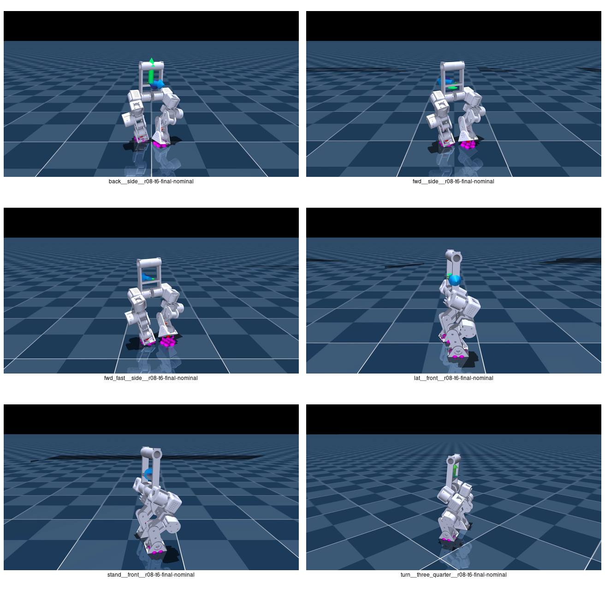

# Pikachu v03 · R08_T6 训练评估报告

评估日期：2026-10-10  
训练 run：`2026-10-09_17-32-05_v03-flat-r08-probe_t6`  
主评估 checkpoint：`model_64996.pt`（SHA256 `048a5620…0958`）  
保守候选 checkpoint：`model_64000.pt`

## 1. 结论摘要

R08_T6 已经解决了 R06 最明显的“小碎步”问题，并提高了后退和侧移能力；但它
**没有解决窄步宽，且暴露出结构参数与训练目标不相容的问题**：

- 标称模型前进 0.40/0.50 m/s 的实测为 0.427/0.532 m/s，后退 −0.30 m/s
  实测 −0.297 m/s；纵向追踪合格。
- 前进步频从 R06 的 6.57–6.86 步/s 降到 4.00–4.29 步/s，每步推进从
  6.1–7.0 cm 提高到 10.7–12.4 cm，已经不是小碎步。
- 侧移 0.25 m/s 只实现 0.104 m/s（跟踪比 0.44），纯转向 0.30 rad/s 只实现
  约 0.002 rad/s，仍不合格。
- 前进行走平均脚距仅 8.9–9.0 cm，低于 R06 的 9.3–9.4 cm；当前 14 cm
  双支撑下限奖励并未被策略满足。
- 静止姿态 RMSE 从 R06 的 0.183 rad 降到 0.092 rad，但左 hip-roll 仍长期处于
  −0.262 rad 硬限位，静止脚距只有 14.3 cm，而初始姿态是 20 cm。
- 前进时左 hip-roll 约 99% 帧、右 hip-roll 约 65% 帧处于扭矩饱和；这不是偶发
  冲击，而是持续控制能力不足。

**参数判断**：6.381 kg 的整机总质量接近 6.3 kg 设计目标，量级合理；但当前
MJCF 仅增加 `base_link.mass`、不更新惯量，同时训练 actuator 把 J3507 限制为
3 N·m、软扭矩奖励却按 9 N·m 计算。再叠加 200 mm 髋宽、267 mm 腿高和仅
±15° hip-roll 行程，模型自然会通过向内收脚降低侧向重力矩。因此当前 R08_T6
适合作为动力学问题定位模型，不应直接作为结构定型或部署模型。

## 2. 评估对象与可复现条件

| 项目 | 值 |
|---|---|
| 训练起点 | R06 `model_59997.pt` |
| R08_T6 训练范围 | iteration 60000–64996，约 5k 续训 |
| 实际任务配置 | `Mjlab-Velocity-Flat-Pikachu-V03-R07` 奖励族 |
| 资产 | `pikachu_v03_base_series_train_weight6.3.xml` |
| 环境数量 | 4096 |
| 控制周期 | 0.02 s（50 Hz） |
| 固定档评估 | 每档 8 s，丢弃前 1 s，actor deterministic |
| 标称数据 | 关闭摩擦、编码器和 base-COM startup DR |
| 鲁棒性样本 | 保留 startup DR，seed 42 |
| 视频 | 标称模型，5 s，1280×720，50 FPS |

run 名为 R08，但保存的 W&B tags 仍含 `r07/gait-refine`。这不影响 checkpoint，
但后续应让 task ID、run 名和 tags 使用同一批次号，避免溯源歧义。

## 3. 训练曲线与 checkpoint 选择

| checkpoint | mean reward | episode length | fell_over | 训练分布 xy 误差 | 判断 |
|---:|---:|---:|---:|---:|---|
| 60000 | −17.64 | 93.55 | 51.92 | 0.473 | 重量突变后的热启动失配 |
| 61500 | 39.60 | 993.50 | 0.083 | 0.204 | 已恢复稳定 |
| 63000 | 42.76 | 999.79 | 0.042 | 0.192 | 基本收敛 |
| 64000 | 44.11 | **1000.00** | **0** | 0.197 | 稳定性最优，保守备选 |
| 64500 | **44.35** | 991.05 | 0.083 | **0.185** | reward/速度误差最优 |
| 64996 | 43.75 | 989.08 | 0.083 | 0.189 | 最终模型，速度档更完整 |

主报告使用 `64996`，因为它在固定档下前进、后退、侧移综合最好；若只看训练
稳定性，`64000` 更保守。两者都受相同的质量/惯量和 3 N·m 执行器问题影响，
修正物理模型前不建议把任何一个标记为 deploy-best。

## 4. 固定命令定量结果

### 4.1 标称机构

| 档位 | 命令 | 实测 | 跟踪比 | 方向 cos | 脚距均值 / P10 | 步频 | 每步推进 | 滑移 |
|---|---:|---:|---:|---:|---:|---:|---:|---:|
| 静止 | 0 | 速度模 <0.001 | — | — | 14.3 / 14.2 cm | — | — | 0.000 m/s |
| 前进 | +0.40 | +0.427 | 1.07 | 1.00 | 8.9 / 8.6 cm | 4.00 步/s | 10.7 cm | 0.115 m/s |
| 快速前进 | +0.50 | +0.532 | 1.06 | 1.00 | 9.0 / 8.5 cm | 4.29 步/s | 12.4 cm | 0.143 m/s |
| 后退 | −0.30 | −0.297 | 0.99 | 1.00 | 8.3 / 7.7 cm | 3.71 步/s | 8.0 cm | 0.068 m/s |
| 左侧移 | +0.25 | +0.104（伴随 x=+0.037） | 0.44 | 0.94 | 12.4 / 8.5 cm | 3.43 步/s | 3.0 cm | 0.054 m/s |
| 原地转 | +0.30 rad/s | +0.002 rad/s | 0.01 | — | 14.3 / 14.1 cm | — | — | 0.001 m/s |

固定档均跑满 8 s、无终止。前进略超调，但 seed-42 DR 样本的 0.40/0.50 档
分别为 0.386/0.483 m/s（跟踪比均约 0.97），说明策略对训练扰动敏感，不能只看
单个标称档。

### 4.2 静止姿态

- 10 个驱动关节相对初始 keyframe 的 RMSE：0.0918 rad（5.26°）。
- 最大偏差：左 hip-roll −0.2623 rad（−15.0°），已经处于机械硬限位。
- 次大偏差：左 ankle +5.4°；其余主要关节约在 ±3.2° 内。
- base height 0.268 m，与 0.26728 m 初始高度一致；静止速度控制本身良好。

R07 的 standing posture L2 有效地把整体 RMSE 降低约 50%，但无法克服侧向
执行器和几何矛盾。继续单纯增大姿态罚权重会牺牲平衡余量。

### 4.3 扭矩饱和

| 档位 | 左 hip-roll 饱和帧 | 右 hip-roll 饱和帧 | 全关节 P99 |
|---|---:|---:|---:|
| 前进 0.40 | 99% | 65% | 1.00 |
| 前进 0.50 | 77% | 71% | 1.00 |
| 后退 | 79% | 26% | 1.00 |
| 侧移 | 42% | 21% | 1.00 |

其它驱动关节几乎不长期饱和，瓶颈高度集中在 hip-roll。当前 `actuator_spec_violation`
为 0 只表示仿真已把输出裁在上限内，不表示存在扭矩余量。

## 5. 与 R06 轻质量基线对比

| 指标 | R06 | R08_T6 | 变化 |
|---|---:|---:|---|
| 前进 0.40 跟踪比 | 1.01 | 0.97（DR42）/ 1.07（nominal） | 保持 |
| 快速前进跟踪比 | 0.97 | 0.97 / 1.06 | 保持 |
| 后退跟踪比 | 0.78 | 0.96 / 0.99 | 明显改善 |
| 侧移跟踪比 | 0.34 | 0.41 / 0.44 | 小幅改善，仍弱 |
| 前进步频 | 6.57 步/s | 4.00–4.29 步/s | 明显改善 |
| 前进每步推进 | 6.1 cm | 9.0–10.7 cm | 明显改善 |
| 快速前进每步推进 | 7.0 cm | 10.6–12.4 cm | 明显改善 |
| 静止姿态 RMSE | 0.183 rad | 0.087–0.092 rad | 约减半 |
| 静止脚距 | 15.3 cm | 14.0–14.3 cm | 变窄 |
| 前进行走脚距 | 9.3–9.4 cm | 8.9–9.0 cm | 未改善 |
| 峰值扭矩占用 | 1.00 | 1.00，且 hip-roll 长时饱和 | 未改善 |

这不是严格的单变量对照：R08_T6 同时改变了质量、奖励和继续训练时间。表格用于
判断最终能力，不用于把全部改善归因于增重。

## 6. 倒立摆与结构尺度分析

### 6.1 质量、质心和时间常数

在初始微屈膝姿态下直接由 MuJoCo 模型计算：

| 参数 | 原轻模型 | weight6.3 | 变化 |
|---|---:|---:|---:|
| 整机质量 | 2.381 kg | 6.381 kg | ×2.68 |
| base 质量占比 | 19.4% | 69.9% | 重量集中到躯干 |
| 整机 CoM 高度 | 0.199 m | 0.282 m | +41% |
| LIP 时间常数 `T_c=sqrt(z_c/g)` | 0.143 s | 0.170 s | +19% |
| LIP 自然频率 `omega=sqrt(g/z_c)` | 7.01 rad/s | 5.90 rad/s | −16% |

线性倒立摆横向方程为：

```text
y_ddot = (g / z_c) (y - p)
capture point ξ = y + y_dot / omega
```

质量在理想 LIP 方程中会消掉，所以“增重”本身不会改变无量纲捕获规律；它通过
提高 CoM、角动量以及执行器所需力矩影响真实机器人。R08_T6 的捕获时间尺度更慢，
这与步频下降一致，但能否稳定落脚最终由侧向可达范围和扭矩决定。

### 6.2 为什么 14 cm 目标与 3 N·m 不相容

重模型重量 `mg=62.60 N`。单脚相对 CoM 横向距离为 `d` 时，准静态重力矩近似：

```text
tau ≈ m g d
```

- 14 cm 对称步宽：`d=7 cm`，需要约 **4.38 N·m**；
- 20 cm 初始步宽：`d=10 cm`，需要约 **6.26 N·m**；
- 3 N·m 能维持的准静态偏距：`d≈4.79 cm`，即对称步宽约 **9.6 cm**。

实测前进步宽 8.9–9.0 cm，正好落在这个预测附近。该计算忽略动量、双支撑和
hip-yaw 轴耦合，只是低阶近似，但它准确预测了策略收脚的量级，也与 hip-roll
长时饱和相互印证。

训练配置存在口径冲突：`ACTUATOR_J3507.effort_limit=3.0`，保存的 `env.yaml`
同样是 3 N·m；但代码注释、电机表和 `torque_soft_limit` 奖励按 9 N·m 计算。
于是 hip-roll 在 3 N·m 已被物理裁剪，而软约束要到 7.2 N·m 才开始惩罚，对这组
关节永远不会生效。必须先确认实机 J3507 的连续/峰值能力，再统一所有口径。

### 6.3 髋宽与腿长比例

- 两髋中心距：200 mm；站姿 base-to-ground 高约 267 mm；比例约 **0.75**。
- 若要让单脚落到骨盆中心下方，每侧需要约 `atan(100/267)=20.5°` 的内收角。
- 当前 hip-roll 机械范围仅 ±0.26 rad（±14.9°），最大几何横移约 71 mm，仍差
  约 29 mm，无法在保持躯干正直时把支撑脚放到中心正下方。

因此，向内收脚本身符合倒立摆的捕获需求；不合理的是“宽髋、短腿、小行程、
重躯干、3 N·m 横滚”同时存在，却要求策略始终保持 14–20 cm 宽步。

### 6.4 base inertia 审核

`base_link` 质量从 0.461569 kg 改为 4.461569 kg，但 `diaginertia` 仍保持
`(0.00116246, 0.00112541, 0.000198703) kg·m²`。横滚/俯仰回转半径因此从约
50 mm 降到约 **16 mm**，偏航回转半径从 20.7 mm 降到 **6.7 mm**。

这只在“新增 4 kg 是位于原 CoM 的理想质点”时成立，不代表实际电池、控制器、
外壳和结构件。若仅按相同形状/质量分布粗略缩放，惯量至少应约为
`(0.01124, 0.01088, 0.00192) kg·m²`；正确做法仍是从整机 CAD 或实测摆锤法导入
质量、CoM 和惯量，并把电池等大质量件建成独立 body。

若目标整机质量必须精确为 6.300 kg，在腿部质量不变时 base mass 应约为
4.380 kg，而不是 4.462 kg；当前总重高约 1.3%，不是主要矛盾，但应统一命名。

## 7. 后续结构设计建议

按优先级执行：

1. **先统一电机真值**：确认 J3507 是 3 N·m 还是 9 N·m，以及连续/峰值和热限制。
   目标 14 cm 步宽在 6.38 kg 下建议至少 6.5 N·m 动态裕量；目标 20 cm 建议接近
   9.5 N·m 峰值能力。
2. **重建质量分布**：不要只改 mass。由 CAD 导出 base、载荷、电池的 mass、CoM、
   完整惯量；对新增载荷使用平行轴定理。
3. **降低髋中心距**：若腿长维持约 267 mm，建议先做 100–130 mm 两档结构仿真；
   对应宽长比 0.37–0.49，比当前 0.75 更适合双足捕获步态。
4. **扩大 hip-roll 行程**：至少 ±25°，建议验证 ±30°；20.5° 只是脚到中心线的
   几何需求，还没有扰动恢复余量。
5. **降低躯干 CoM**：电池和高密度部件尽量下移到髋轴附近。较低 CoM 会缩短 LIP
   时间常数，但显著降低同一倾角/位移下的倾覆势能和关节负载。
6. **不要靠加宽脚底掩盖根因**：脚底可适当增加横向 CoP 范围，但它不能修复
   swing-leg 可达性和 hip-roll 饱和，只能作为最后的小幅鲁棒性优化。

若 200 mm 髋宽不可改，另一条路线是把有效腿长提高到 350–400 mm，并同时扩大
hip-roll 行程；仅加长腿但不处理执行器扭矩，仍会在重躯干下收脚。

## 8. 后续训练建议（建议批次 R08_T7）

### 8.1 先修模型，再调奖励

- 让 actuator limit、telemetry 分母、软扭矩奖励全部从同一个硬件常量生成，禁止
  `3 N·m actuator + 9 N·m reward`。
- 惯量或结构几何改变后，actor 可以热启动，但 critic 和 optimizer 建议重置；
  学习率从 `1e-4` 左右开始，不沿用旧动力学的价值函数。
- 初期关闭 base-COM DR；当前 ±25 mm 随机偏移因 base 占整机质量 69.9%，会造成
  最多约 17.5 mm 整机 CoM 偏移和约 1.09 N·m 重力矩，已占 3 N·m 的 36%。

### 8.2 把“宽度奖励”改成捕获点落脚

不再全局要求 `walking_stance_width >= 0.14 m`。建议：

- 保留左右脚**不交叉**的 signed barrier，例如落地时
  `y_left - y_right >= 0.04–0.06 m`；
- 在落脚事件上计算 `ξ_y = y_com + v_com_y / omega`，目标为
  `p_foot_y = ξ_y + side × b`，先用 `b=0.04–0.05 m`（目标动态脚宽约 8–10 cm）；
- 若结构/电机修改后有余量，再把 `b` 课程化增加，而不是一开始硬推 14 cm；
- 静止仍用完整 keyframe L2，但增加“距关节硬限位 2–3°”的 barrier，避免左
  hip-roll 用撞限位换平衡。

### 8.3 命令分布与课程

当前剩余 25% heading 环境同时带随机线速度，没有纯转向桶，这解释了固定纯转向
几乎为零。建议独立采样：

| 桶 | 建议占比 |
|---|---:|
| 静止 | 10% |
| 前进 | 20% |
| 后退 | 15% |
| 侧移 | 20% |
| 纯 yaw | 15% |
| 线速度 + yaw 混合 | 20% |

训练课程建议：前 2k 使用 `vx≤0.35, |vy|≤0.15, |wz|≤0.20` 且无 base-COM DR；
2k–6k 放开到当前范围并加入 ±5 mm CoM；通过固定档后才按实机装配公差扩展 DR。
短步惩罚和 0.28 s air-time 目标已经取得效果，不建议继续加大。

### 8.4 下一批硬验收线

- 20 s 六档零终止；10 个不同 DR seed 也必须通过。
- 前进/快速前进跟踪比 0.95–1.05，后退 ≥0.90，侧移 ≥0.60，纯 yaw ≥0.60。
- 前进步频 3.5–4.5 步/s，每步推进 ≥9 cm。
- 不交叉脚 barrier 零违规；动态脚宽目标随结构版本单独设定，不再盲用 14 cm。
- 任一 hip-roll 扭矩饱和帧占比 <5%，全关节 P99 <0.90。
- 静止姿态 RMSE ≤0.06 rad，任何关节均离硬限位 >3°。
- 标称前进脚滑移均值 <0.08 m/s；当前 0.115–0.143 m/s 仍偏高。

## 9. 视频与数据



六段视频均经 `ffprobe` 校验为 1280×720、50 FPS、250 帧、5.000 s：

- [静止 · 正面](videos/stand__front__r08-t6-final-nominal.mp4)
- [前进 0.40 · 侧面](videos/fwd__side__r08-t6-final-nominal.mp4)
- [前进 0.50 · 侧面](videos/fwd_fast__side__r08-t6-final-nominal.mp4)
- [后退 −0.30 · 侧面](videos/back__side__r08-t6-final-nominal.mp4)
- [侧移 +0.25 · 正面](videos/lat__front__r08-t6-final-nominal.mp4)
- [原地转 +0.30 · 3/4 视角](videos/turn__three_quarter__r08-t6-final-nominal.mp4)

逐帧 CSV 在 [metrics/](metrics/)；`*-nominal.csv` 是标称机构，未带 `nominal`
后缀的一组是 startup DR seed 42。资产和评估条件的机器可读摘要见
[manifest.json](manifest.json)。

## 10. 最终决策

**保留 `model_64996.pt` 作为 R08_T6 的分析基线，同时保留 `model_64000.pt`
作为稳定性备选；暂停继续堆叠步宽奖励。** 下一步先确认 J3507 扭矩真值并重建
base 惯量，再用“当前几何 / 窄髋结构”做 A/B 仿真。若硬件确为 3 N·m，当前质量
下约 9–10 cm 动态脚宽是物理一致的结果；若产品目标必须是 14–20 cm，则必须改
执行器、髋宽/腿长或质量分布，不能只靠强化学习参数解决。

