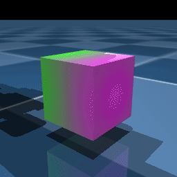

=========
Changelog
=========

Upcoming version (not yet released)
-----------------------------------

Added
^^^^^

- Added frozen-source V033 E1 training workers and a durable 4096-environment,
  20000-iteration paired queue with checkpoint hashes, nominal evaluations,
  validated review videos and live reports. Added an isolated three-trial PPO
  autoresearch workflow demo with preserved candidate commits and rollback.

- Added an independent Pikachu V033 upright E1 task with all 18 policy outputs,
  asymmetric soft arm-position windows, selective arm-leg mesh contact and a
  10-mm detection-only proximity penalty. Updated BIPED_KEYFRAME arm roll to
  left -53 / right +53 degrees. Added command-gated quiet-standing costs,
  standing-aware pushes, aligned right/left foot-height sensing, and separate
  biped_e1 experiment logs and validation tools.

- Added an independent Pikachu V033 Crawl velocity task with calibrated
  four-bar closure, four support contacts, horizontal velocity observations,
  tilted posture control, and reproducible paired training/video review tools.
  Organized paired artifacts under ``logs/rsl_rl/pikahcu_v033/<subtask>/``
  with migration provenance and checkpoint-specific playback instructions.
  Updated the crawl reset arms to mirrored 90-degree roll and zero elbow;
  recorded the resulting endpoint heights for posture review.
  Set both crawl arm yaw joint coordinates to positive 90 degrees and retain
  all 18 policy actions, including elbows.
  Added an independent Crawl-E1 variant with a quadratic soft penalty beyond
  a five-degree arm roll/yaw posture window and a separate crawl_e1 namespace.
  Allowed pinned dummy-agent reset.
  Replaced crawl hand spheres with the original elbow STL mesh collision geoms
  and aligned support reference sites and swing-height rewards to their surface.
  Removed the inherited V033 biped reset height lift and enabled crawl velocity
  debug arrows in the horizontal command frame.

- Added ``play --viewer velocity-joystick``: a Viser panel with ``vx`` / ``vy``
  / ``wz`` sliders that drives ``VelocityMatchMotionCommand`` live, so the
  distilled student policy can be verified interactively the way the velocity
  tasks are (send a velocity command, the robot matches the reference motion
  itself). Changing a slider rewrites ``velocity_command`` and re-runs the
  nearest-neighbour clip match; the reference then loops inside its own clip
  with a **phase-continuous** fold (whole gait periods are subtracted from
  ``time_steps``), so the robot neither teleports when the clip ends nor sees
  a phase jump in ``gait_phase``. Pair it with ``--no-terminations True`` —
  with the default 10 s episodes the robot would be re-seeded to a reference
  start pose every 10 seconds. By default the slider only **selects** the
  reference — the command actually handed to the policy is snapped to the
  matched clip's measured steady-state velocity. That is the only command value
  the student ever trained on: this library's Voronoi half-widths collapse to
  ~4e-4 (near-duplicate clips such as ``walk_0.185_0.0_0.0`` /
  ``walk_0.37_0.0_0.0``, both measuring 0.188 m/s, sit ~1e-3 apart), so
  ``command_jitter`` contributes nothing and training commands are 25 discrete
  points. Feeding an in-between command degrades the gait into a shuffle —
  measured on the vx axis, ``0.118`` gives 0.015 m/s over a 0.017 m stride,
  while the snapped command gives 0.172 m/s over 0.130 m. A checkbox disables
  snapping for side-by-side comparison, and the panel always shows both the
  requested and the executed command.
- Added a **2D joystick** to the ``play --viewer velocity-joystick`` panel,
  replacing the previous direction pad. It is a circle with a knob that can be
  dragged in any direction, drawn as an SVG injected into the panel with
  ``RunJavascriptMessage`` — viser 1.0.27 has no 2D pad widget and no
  custom-component API. The vertical axis is ``vx`` (up = forward) and the
  horizontal axis is ``wz`` (right = turn right, so the sign is flipped —
  positive ``wz`` is a left turn); ``vy`` stays off the pad and is only
  reachable through its own slider. The outer ring is each axis' maximum
  command (the fastest reference in the library, read from ``clip_command``
  rather than hard-coded), the dashed inner circle is a dead zone (inside it the
  command is exactly zero), and pushing past the ring clips to the maximum.
  **Releasing the knob recenters it and zeroes both axes**, making the pad a
  hold-to-move control; pointer cancel and double click recenter the same way.
  The three sliders stay, and remain the only way to request an in-between
  command; the knob writes to them by dispatching synthetic mouse events, so the
  joystick and the sliders always carry the same command. The ``wz`` button
  group (left / stop / right) is unchanged and still latches — that is how to
  keep turning without holding the pad. Both axes are emitted one per client
  throttle window: the client's GUI updates pass through a **shared** 50 ms
  leading/trailing throttle with a single ``latestMessage`` slot, so updating
  two sliders back to back silently drops one of them (measured: the slider
  read 0 while Python still held the first drag step's 0.13). Alternating the
  axes 55 ms apart keeps each message first in its own window, at the cost of
  ~110 ms per axis. Move and release listeners are bound to ``window`` rather
  than to the SVG: once the pointer leaves the pad the element stops receiving
  ``pointermove``, and ``setPointerCapture`` did not survive the first move in
  testing, which silently froze "drag past the ring clips to maximum" at
  whatever value it had when the pointer left.
- Added ``preview_cli --loop-reset`` (default **on**): on looped playback,
  kinematically reset the robot back to the initial pose (root pos/rot + joint
  angles, i.e. the trajectory's first frame) before each repeat. The plain
  ``--loop`` wrap-back segment only eases joint targets back while ``root``
  keeps evolving freely under ``pd`` mode (``write_root=False``); this instead
  actually returns the base to its initial position — ideal for repeatedly
  inspecting root-drift motions like fall-and-get-up. It also skips the
  end-to-start interpolation segment (the trajectory is just the action); pass
  ``--loop-reset False`` to restore the smooth rewind loop.
- Replaced the preview's default backend with a **viser browser viewer**:
  ``preview_cli`` now opens ``--backend viser`` (browser 3D, no local
  GL/display required — the server only runs a websocket, so it also works on
  headless hosts) and ships an interactive panel with a frame progress slider,
  Play/Pause, Reset, a dropdown to hot-swap keyframes JSON (``--json-dir``
  controls the listed directory; the current path is folded in automatically),
  and hot-reload widgets for easing/fps/mode/write_root/loop/loop_reset/fast/
  show_com — editing keyframes or parameters no longer requires relaunching.
  The previous ``launch_passive`` desktop viewer stays available as
  ``--backend native``.
- Added ``play --weld``: constructs a **true rigid monolith** for the most basic
  static standing on GPU/warp. The scene MjSpec has every internal hinge/ball
  joint replaced by an ``mjEQ_WELD`` equality and all actuators removed, yielding
  a single free-jointed rigid body that rests on its feet under plain gravity —
  no base-balance wrapper, no viewer per-substep position writes. On warp it
  stands still >3s (``up_z≈1.0``, ``dx<1mm``), the standalone pose the soft-PD
  ``--agent frozen`` path cannot hold. Use with dummy agents
  (``uv run play <TASK> --agent frozen --weld``); ``--freeze-joints`` /
  ``--balance`` are forced off because a monolith has nothing for those hacks
  to act on.
- Added ``Mjlab-Velocity-Flat-Pikachu-Quad-Bounding`` as an isolated forward
  quadruped bounding task. It uses separate front-hand and rear-foot contact
  sensors, an ordered rear-stance / flight / front-stance / flight reward,
  synchronized pair landings, and its own PPO experiment and W&B namespace.
  The existing Quad and biped task configurations remain unchanged.
- Added ``Mjlab-Velocity-Flat-Pikachu-Quad``, a Pikachu **quadruped** omnidirectional
  velocity task: the robot starts in the shared ``QUAD_KEYFRAME`` pose (hands + feet
  on the ground, torso pitched forward) and learns to move in all directions with the
  front legs (= arms) as support. It is isolated in a new independent namespace —
  ``asset_zoo/robots/pikachu/pikachu_quad_constants.py`` (quad start pose, support
  geoms, action scale) and ``tasks/velocity/config/pikachu_quad/`` (env / rl cfg), with
  a private ``quad_mdp`` whose ``quad_upright`` / ``quad_bad_orientation`` target a
  torso back-axis at a ``tilt_deg`` offset (parameterized and marked TODO until
  calibrated in the viewer). Shared ``pikachu_constants`` and the shared velocity
  mdp are untouched, so the existing biped tasks are unaffected.
- Added ``uv run start_server``: a local experiment dashboard that discovers
  registered tasks, the newest checkpoint in every ``logs`` / ``pre_train``
  run, and local motion NPZ files. It builds copyable TrainSpec-compatible
  train, play, response, and tracking-evaluation commands; matches motions from
  checkpoint ``params/env.yaml``; checks existing MjLab processes and GPU use;
  and launches, monitors, logs, or stops an experiment from the browser.
- Viser play jobs started from the dashboard now expose a direct browser link
  and a copyable SSH port-forward command. Stale zombie GPU rows and launcher
  processes are reported separately from active conflicts, and stopping a job
  terminates every live process in its launch session.
- Added ``uv run response <TASK>`` for automated, limit-aware step and sine
  actuator tests in a fixed-base, terrain-free, collision-disabled suspended
  scene. Runs export raw ``mjlab-response-v1`` samples, dynamic-response
  summaries, and per-joint motor/PD/model metadata for motor sizing.
- Added ``response_csv_dashboard.html`` with synchronized response plots,
  rise/settling/overshoot analysis, Bode fitting and THD, torque-speed demand,
  adjustable sizing safety factors, and derivation of the local motor/gearbox/
  PD closed-loop model.

- Added ``Mjlab-Tracking-Flat-Pikachu-Walk``, a Pikachu motion-tracking task
  that learns the recorded 0.185 m/s forward walk and reuses the transition
  task's robot, tracking bodies, randomization, telemetry, and PPO setup.
- Reworked ``Mjlab-Tracking-Flat-Pikachu-Walk-Base`` into a true arm ablation:
  the policy input, output, and reference are trimmed to the 10 leg joints only,
  and the arms are driven by a new zero-dimension ``ArmSineAction`` side-effect
  term (``envs/mdp/actions/arm_sine.py``) that superimposes an anti-phase sine on
  the default arm pose every physics substep. A training curriculum ramps the
  swing amplitude from 0 (first ~1000 iters learn stable walking with arms still)
  to ``default_amp_pitch`` / ``default_amp_roll`` over the following ~2500 iters.
  The ``--viewer arm-swing`` player now drives that term's pitch/roll amplitude
  and frequency directly via Viser sliders instead of rewriting policy actions.
  Added ``scripts/make_walk_base_npz.py`` to produce the leg-only (10-DOF)
  reference NPZ from the 14-DOF forward-walk clip.
- Added ``mjlab.mocap``, a MuJoCo data-recording environment for Pikachu
  (PD keyframe + interpolation → CSV, aligned with ``csv_to_npz.py`` input).
  It loads the Pikachu robot on flat terrain, drives joints via position
  actuators while guiding the floating root kinematically along the
  interpolated keyframe path, and writes per-frame root pose (xyzw quat) +
  14 DOF joint angles as 21-column CSV. Interpolation is configurable
  (fps / easing / slerp). Includes a ``record_cli`` and example keyframes.
- Added ``csv_to_npz_pikachu.py``, a Pikachu port of the G1 motion
  ``csv_to_npz.py`` converter: same input CSV contract and ``motion.npz``
  output schema, but loads the Pikachu robot and maps its 14 joint names
  directly (no manual ``joint_names`` substitution). It also adds an
  opt-in ``--wandb`` flag (upload disabled by default).
- Added ``mjlab.mocap.preview``, an interactive viewer preview for keyframe
  motions: it plays the interpolated trajectory in a native MuJoCo window
  (``mujoco.viewer``) in either ``kinematic`` mode (interpolated target
  poses) or ``pd`` mode (the same PD execution used by recording), with
  space-to-pause and optional looping. Backed by ``MocapEnv.sync_to_mj_data``
  which copies the latest warp state into the host ``MjData`` for rendering.
- ``mjlab.mocap.record_cli`` now also accepts positional ``keyframes`` /
  ``out_csv`` arguments (e.g. ``record_cli config.json out.csv --fps 30``),
  in addition to the ``--keyframes`` / ``--out-csv`` flags.
- Added ``uv run viewer <TASK>``, a live collision-body tuning viewer that
  opens any registered task directly (mimicking ``play`` argument parsing).
  By default the robot is suspended in the air (``--suspend-height``) with
  physics paused so its collision bodies can be inspected from any angle;
  ``--zero`` / ``--random`` enable simulation and let it land. Supports
  ``--xml <path>`` to override the robot MJCF with hot-reload on save,
  highlights collision bodies (``*_collision`` geoms or ``group=3``), and
  exposes console commands ``list`` / ``scale`` / ``pos`` / ``color`` /
  ``r`` / ``q`` for in-memory geometry tuning.
- ``mjlab.mocap.preview`` now overlays the whole-robot center of mass (COM)
  and its ground projection in the viewer by default: a green dot at the
  COM, a vertical yellow line down to the ground, and a red dot at the
  projection point — useful for judging balance (whether the COM projection
  stays inside the support polygon) in pure joint-angle mode. Disable with
  ``--show-com False``.
- Added ``mjlab.mocap.replay``, a viewer replay for **recorded** motions
  (``replay_cli``): it loads either the ``record_cli`` CSV (21-column
  mocap format, ``--input-fps`` required) or the ``csv_to_npz_pikachu``
  output npz (fps read from the file) and plays the captured root pose +
  14 DOF joints back in a native MuJoCo window in ``kinematic`` mode
  (write the recorded trajectory directly). A ``pd`` mode is available
  for **CSV** recordings only (approximating the recorded PD dynamics,
  optional ``--write-root``); for ``npz`` — a purely kinematic reference
  sequence consumed by tracking training, unrelated to dynamics — ``pd``
  is meaningless and is forced back to ``kinematic``. Reuses the COM
  projection overlay and space-to-pause / loop / fast interactions from
  ``preview`` — useful to inspect recording results before training.
- Added ``check_reference_feasibility.py``, an offline feasibility check for
  reference-motion NPZ files before they enter tracking training: it reports
  hovering feet (sole height), stance-phase foot sliding, joint position/
  velocity vs hardware limits and DM motor speed spec, and a ``feasible``
  verdict plus an issues list.
- Pikachu telemetry now adds stance-phase foot-slip velocity and slide
  fraction (same threshold and wording as the offline check), per-joint peak
  torque/velocity as a ratio of the DM motor spec
  (``joint_torque_ratio`` / ``joint_velocity_ratio``), an aggregate
  ``actuator_spec_violation`` step fraction, and mean action acceleration
  (action smoothness) to every velocity and tracking task. Tasks that do not
  already define ``feet_ground_contact`` get the sensor added automatically.
- ``play`` now accepts ``--freeze-joints {True,False}`` to override the viewer's
  "Freeze to default (absolute rigidity)" initial state (default ``None``
  follows the agent: on for dummy agents zero/random/frozen, off for trained).
  The weld can still be toggled live afterwards (viser checkbox / native L key).
- ``play`` now accepts ``--balance {True,False}`` to override the frozen/zero
  base-balance wrapper (altitude/attitude springs that hold the base up on GPU
  warp sims). ``--balance False`` removes the wrapper so an external force
  produces the true rigid-body tip-over instead of stopping at a balanced tilt;
  ``None`` follows the agent default (on for zero/frozen, inert for trained).
- ``play`` now accepts ``--foot-friction <float>`` and ``--foot-scale <float>``
  to decouple the two stand-failure modes on the 27-dof biped: a low
  ``--foot-friction`` (e.g. ``0.05``) makes the feet slide under a side force,
  and a high value (e.g. ``3.0``) or a smaller ``--foot-scale`` (e.g. ``0.5``)
  makes them tip over instead. ``--foot-scale`` scales the sole contact area in
  x/y (``2.0`` doubles it, ``0.5`` halves it); the sole thickness is untouched.
  Both default to ``None`` (model default). For cleanly separate failure modes
  combine them as ``--balance False --freeze-joints True``.

Changed
^^^^^^^

- The Viser reward bar panel no longer caps itself at 20 terms:
  ``ViewerConfig.reward_bar_max_terms`` now defaults to ``None``, which shows
  every term. ``Mjlab-Velocity-Flat-Pikachu-V03-T6`` carries 24 reward terms and
  warned on every viewer startup, hiding the four newest ones (the T6 gait and
  torque terms) — exactly the terms being watched. The panel scrolls, so term
  count was never a reason to hide any of them; set the field to a number to
  keep the panel short.
- The Pikachu 27-dof ``KNEES_BENT_27DOF_KEYFRAME`` is now a real crouch computed
  by a planar analytic IK (``leg_offset = −hip + knee − ankle`` keeps the foot
  level; the symmetric in-limit solution ``hip=+0.52, knee=+1.02, ankle=+0.50``,
  left/right legs have identical joint axes so take the same sign). The base
  height is raised to ``z=0.168`` so the foot bottoms land exactly on the ground
  instead of the old straight-leg pose that sank into the floor.
- ``play --com`` now overlays a per-foot slip light on each planted foot: green
  (usable friction margin ``μ·Fₙ − |Fₜ|`` ≥ 20% of the cone), yellow (friction
  cone ≥ 80% used), or red when tangential force exceeds the cone (`μ·Fₙ < |Fₜ|`).
  The contact force and μ come from the ``feet_ground_contact`` sensor, so tasks
  without it silently skip the overlay.
- ``play --agent frozen`` now defaults **Freeze Joints** to *on* for dummy agents:
  every actuated joint (all 27) is welded to its default KNEES posture each physics
  pre-step, so the robot enters as a single rigid body for static-stability /
  anti-disturbance testing. In the Viser viewer this is the "Freeze Joints" toggle
  (checkbox, default on); in the native MuJoCo viewer it is the **L** key (also
  default on for dummy agents). **L** is used because **F** is reserved by MuJoCo's
  native "show contact forces" shortcut. Trained agents leave it *off* so a learned
  policy's own actions are not overridden. An empirical GPU-Warp sweep
  (μ = 0.6..3.0, frozen, F = 0) showed the residual F=0 drift/fall is *not* friction
  limited — raising ground friction does not stop it — so the friction default stays
  0.6 and the "slip" is instead traced to GPU-Warp contact-fidelity rather than μ.
- Plot-log dashboards now auto-discover and load the newest matching CSV below
  ``logs/`` through a read-only local server. The actuator-response dashboard
  also shows raw per-frequency sine time histories, renders model equations
  with LaTeX, and explains NaN values from unknown datasheet fields, unmet
  time-domain criteria, or insufficient frequency coverage.

- Retuned the Pikachu velocity task for a natural walking gait: supported,
  alternating footfalls replace the exploitable per-step air-time reward;
  sustained double-flight and vertical base motion are penalized; a lower body
  target, 4 cm foot clearance, smoother actions, and balanced forward/backward/
  lateral command buckets reduce tiny rapid steps and hopping.
- Added per-joint signed position, velocity, and actuator-torque Metrics for
  every Pikachu velocity and tracking task. Training logs report episode peak
  magnitudes for motor sizing, while the Viser Metrics tab provides live
  per-joint plots plus Position, Velocity, and Torque selection shortcuts. The
  selected curves can be recorded beside the active checkpoint as CSV, then
  reopened from the server or uploaded through the browser for offline plots.
  Checked offline curves can also be exported under ``images/<csv-name>/``:
  joint images are grouped by signal and side, with per-side/all-joint overviews
  and a seven-row left/right comparison. A standalone CSV dashboard provides
  the same taxonomy, interactive zoom, peak/RMS/P95 statistics, and selected
  PNG/CSV downloads.
- ``mjlab.mocap`` now drives the floating base with **pure dynamics by
  default**. ``MocapEnv`` initializes the root from
  ``default_root_state`` instead of the compiled ``qpos0`` (whose free-joint
  segment left the robot embedded in the ground and flipped), and
  ``record_to_csv`` / ``record_cli`` / ``preview`` default to
  ``write_root=False``, so keyframe JSONs only need to specify joint angles
  and the recorded root pose/position is the robot's real floating-base
  dynamics response (root is free to evolve, balance or fall over).
  ``write_root=True`` keeps the old guided mode (root kinematically pinned to
  the interpolated path) for debugging keyframe poses or large root
  re-orientations such as the quadruped pitch-over transition. A pure
  joint-angle example is added at ``mocap/configs/biped_squat_stand.json``.
- ``csv_to_npz_pikachu.py`` now writes its ``.npz`` output to the project by
  default: ``src/mjlab/mocap/npz/{output_name}.npz`` (created on demand,
  one file per distinct ``--output-name``) instead of a hardcoded
  ``/tmp/motion.npz``. A new ``--output-file <path>`` flag overrides the
  destination. This also changes the wandb artifact source: with ``--wandb``,
  the artifact now uploads from the project ``npz`` path.

Fixed
^^^^^

- ``play`` on a multi-clip tracking task (``MultiMotionCommandCfg``) no longer
  demands ``--motion-file``: those tasks carry their own ``motion_files``
  library in the env cfg, so replaying them with ``--checkpoint-file`` now
  works instead of raising "Tracking tasks require ``motion_file``".
- ``tests/test_start_server.py``: restored the truncated ``play`` command
  assertion (missing task name and tuple close) that was a syntax error and
  blocked ``make check``.
- ``csv_to_npz_pikachu.py``: the lazy ``import wandb`` inside ``run_sim``
  shadowed the ``wandb: bool`` parameter; the module is now imported as
  ``wandb_mod`` so the artifact upload path type-checks.
- ``Mjlab-Tracking-Flat-Pikachu-Lite-Distill``: the default teacher checkpoint
  globbed ``logs/rsl_rl/pikachu_lite_tracking/*/model_*.pt``, which silently
  resolves to a **pre-left-leg-sign-fix** teacher once the fixed run gets its
  own top-level directory (``pikachu_lite_tracking_signfix``). It now globs
  ``pikachu_lite_tracking*``, matching ``scripts/train_student.sh``.
- ``scripts/plot_logs/metrics_csv_dashboard.html`` no longer requires a
  ``time_s`` column. The time axis is the first **numeric and non-decreasing**
  of ``time_s`` / ``time`` / ``sim_step`` / ``step`` / ``iteration`` / ``iter``
  / ``epoch`` / ``frame`` / ``sample``, falling back to the row index (labelled
  样本序号) when none is present, so training-trend CSVs that only carry ``iter``
  load directly; the chosen column is excluded from the plotted metrics.
- The same dashboard no longer hard-codes the joint list. Every
  ``left_/right_<joint>_joint`` column is discovered from the CSV, so a robot
  that names a joint differently still appears in the left/right comparison,
  the T-N quadrant panel and the inertia view — pikachu_v03's knee is
  ``knee_up``, not ``knee``, and previously vanished from all three. An
  alias table (``JOINT_ALIASES``, currently ``knee_up -> knee``) lets a renamed
  joint reuse a known joint's actuator spec and inertia defaults.
- ``play --viewer velocity-joystick``: the panel's 归零 button zeroed the
  command handed to the policy but left the three sliders where they were, so
  "滑条请求" and "实际执行" disagreed the moment it was pressed. A slider's
  position is owned by its viser handle, so the handler now writes ``0.0`` back
  to the handles; that fires their ``on_update`` callbacks, which zero the
  Python-side command too.

Version 1.6.0 (August 8, 2026)
------------------------------

.. admonition:: Breaking API changes
   :class: attention

   - ``CollisionCfg`` now requires ``contype``, ``conaffinity``, ``condim``,
     and ``priority`` to be explicit instead of silently defaulting to
     MuJoCo's values, and dict values for these fields must cover every
     matched geom (add a catch-all ``".*"`` entry).
   - ``CommandTerm._update_command`` now takes an ``env_ids`` argument:
     ``None`` on the regular per-step update and the reset environment ids
     when called from ``reset()``. Custom command terms must add the
     parameter (construction raises a ``TypeError`` with migration
     instructions otherwise) and scope any per-step state advance, such as
     a motion frame index, to ``env_ids``.
   - ``ViewerConfig`` is now keyword-only; positional construction no
     longer works.

.. admonition:: Highlights
   :class: note

   - Upgraded to MuJoCo and MuJoCo Warp 3.11.
   - Upgraded ``rsl-rl-lib`` to 5.4.2.

Added
^^^^^

- Added ``GeomCfg``, exposed as the ``geoms`` field on ``EntityCfg``, a spec
  editor that matches geoms by name and patches their attributes. Supports
  ``group`` (so a geom can collide without being drawn) and all collision
  attributes; unset attributes are left untouched. Contribution by
  @bd-pmorais.
- Added ``diffuse``, ``specular``, ``ambient``, ``active``, and
  ``attenuation`` fields to ``LightCfg`` for configuring light color and
  falloff. Contribution by @bd-pmorais.
- Added ``random``, ``file``, ``cubefiles``, ``gridsize``, ``gridlayout``,
  ``nchannel``, ``hflip``, and ``vflip`` fields to ``TextureCfg``, so textures
  can be loaded from image files instead of only built-in patterns.
  ``width`` and ``height`` are now optional, since file-based textures take
  their size from the image. Contribution by @bd-pmorais.
- Added light domain randomization functions: ``dr.light_diffuse``,
  ``dr.light_specular``, ``dr.light_ambient``, ``dr.light_attenuation``,
  ``dr.light_cutoff``, and ``dr.light_exponent``. Contribution by @bd-pmorais.
- Added ``reduce="sum"`` to ``MetricsTermCfg`` for reporting the accumulated
  episode total (e.g. episodic reward, total distance traveled) instead of a
  per-step average. Contribution by @bd-mlutter
- Added ``ViewerConfig.geom_group`` and ``ViewerConfig.site_group`` to
  control which geom and site visualization groups the offscreen renderer
  draws. Defaults match MuJoCo's (groups 0 through 2), so rendering is
  unchanged unless configured. Contribution by @bd-mlutter.
- Added ``dr.mat_texid`` to randomize which texture fills a given
  ``mjtTextureRole`` slot (RGB by default) of each selected material,
  sampling uniformly from ``asset_cfg.texture_names``. Contribution by
  @bd-pmorais.

Changed
^^^^^^^

- Bumped ``mujoco`` and ``mujoco-warp`` from 3.10 to 3.11, and regenerated the
  bundled MuJoCo type stubs.
- Bumped ``rsl-rl-lib`` from 5.4.0 to 5.4.2.
- ``CollisionCfg`` and ``GeomCfg`` now share one write path, and mjlab warns
  when a ``GeomCfg`` collision patch is overwritten by a ``CollisionCfg``.
- Changed the default MuJoCo Warp render background to solid black
  (``0, 0, 0, 1``), matching MuJoCo's native renderer. Contribution by
  @bd-pmorais.
- The offscreen renderer now works on a copy of the ``MjModel``, so its
  render-only tweaks (extent, shadows, reflections, offscreen size) no
  longer leak into the shared model. Contribution by @bd-mlutter.
- ``ViewerConfig`` is now keyword-only, with fields grouped and documented.
  Contribution by @bd-mlutter.
- ``ViewerConfig.fovy`` now also applies to the ``ASSET_ROOT`` and
  ``ASSET_BODY`` tracking cameras instead of being silently ignored; leave
  it at ``None`` (the default) to keep the model value. Contribution by
  @bd-mlutter.
- ``auto_reset`` and an explicit ``reset()`` now leave identical command and
  event timer state (:issue:`1133`).

Fixed
^^^^^

- The Viser motion scrubber's Start Here button no longer computes relative
  body poses from stale pre-scrub kinematics, which could spuriously
  terminate the episode on the next step.
- Mid-episode lifting command resamples now refresh kinematics and the
  multi-cube reward cache, so observations and rewards no longer see
  pre-teleport object positions for one step after each resample.
- ``UniformVelocityCommand``'s ``init_velocity_prob`` path no longer writes
  the previous episode's terminal pose back into the sim on reset. It read
  derived kinematics before ``forward()`` ran and rewrote the root pose; it
  now reads only qpos for the orientation and writes only the root velocity.
- ``init_velocity_prob`` now applies on episode reset only. A mid-episode
  timer resample used to also teleport the root velocity, which ran after
  ``step()``'s forward and left velocity observations stale for one step.
- ``Entity.set_joint_position_target`` and its velocity/effort/tendon/site
  siblings now select the outer product when both ``env_ids`` and the element
  ids are tensors, instead of pairing them elementwise.
- ``MotionCommand`` now refreshes kinematics after a timer-expiry resample
  (finite ``resampling_time_range``), matching its wraparound path.
- ``CircularBuffer`` lag retrieval now clamps to the oldest retained frame;
  a lag beyond the buffer length used to wrap around to a newer frame.
- Camera sensor caches are now invalidated after ``sense()``, so a
  pre-sense read with ``clone_data=True`` can no longer pin the previous
  step's frame into the observations (mirrors the raycast fix for
  :issue:`998`).
- ``reset(env_ids=...)`` no longer appends a frame to every env's observation
  history and delay buffers; only the reset envs receive their post-reset
  frame. Previously, each manual partial reset gave the other envs a duplicate
  frame, shortening their effective history and drifting their delay
  schedules.
- ``reset(env_ids=...)`` no longer advances stateful commands in
  environments that were not reset. Previously a partial reset gave every
  environment an extra command update, so with ``auto_reset=False`` a
  ``MotionCommand`` reference motion played at twice the normal speed and
  could teleport non-reset robots via the wraparound resample. The adaptive
  sampling EMA also no longer folds on resets, matching auto-reset
  training dynamics. :issue:`1138`
- Interval event timers are now resampled on episode reset for function-based
  terms, as documented. Previously the countdown carried across episodes, so a
  new episode's first ``push_robot`` in the velocity and tracking tasks could
  fire arbitrarily soon after spawn; with mixed function and class interval
  terms, reset also wrote into the wrong timer slots. Note this changes push
  timing relative to earlier training runs, and an interval term whose range
  exceeds the episode length is now re-armed on every reset and will never
  fire.
- ``RayCastSensorCfg.include_geom_groups`` now raises on values outside
  ``[0, mjNGROUP)`` instead of silently excluding every geom.
- Geoms with a negative group no longer pick up group 5's visibility toggle in
  the Viser viewer.

Version 1.5.3 (July 22, 2026)
-----------------------------

Changed
^^^^^^^

- The Viser reward bar panel's term cap is now configurable via
  ``ViewerConfig.reward_bar_max_terms``, so environments with more than 20
  reward terms can show them all. Defaults to 20, preserving previous behavior.
  :issue:`1079`

Fixed
^^^^^

- Bumped ``pillow`` (12.3.0), ``onnx`` (1.22.0), and ``soupsieve`` (2.9.1) in the
  lockfile to pick up security fixes.
- Fixed raycast sensor debug visualization and observations lagging one step
  behind the sensed hits. ``sense()`` rebinds the hit tensors after the cache had
  already been repopulated by a pre-sense reward read, so ``.data`` returned the
  previous step's hits; the cache is now invalidated after ``postprocess_rays``.
  With ``ray_alignment="yaw"`` this made debug rays appear tilted by the foot's
  per-step motion instead of vertical. :issue:`998`
- Restored ONNX uploads and W&B run metadata for velocity and manipulation
  training when using RSL-RL's current ``WandbLogWriter`` logger name.
- The Viser reward bar panel no longer *silently* drops reward terms beyond
  ``max_terms``; it now emits a warning listing the hidden terms. Previously
  environments with more than 20 reward terms had the overflow disappear from
  the bar panel with no indication. :issue:`1079`
- Fixed the ``terrain_levels_vel`` curriculum promoting every env from level 0
  to level 1 on the initial reset, ignoring ``max_init_terrain_level=0``. Before
  the first step the robot sits at its spawn pose rather than a walked-to
  position, so the distance check was spurious; terrain levels are now frozen on
  that first reset. :issue:`1094`
- Fixed the velocity task's actor ``joint_pos`` observation not being biased by
  the ``encoder_bias`` domain randomization, so the encoder bias only affected
  actions and never the observed joint positions. The actor now observes biased
  joint positions while the critic keeps the true (unbiased) values as
  privileged information, matching the tracking task.
  See `discussion #1065 <https://github.com/mujocolab/mjlab/discussions/1065>`_.
- Hardened ``fit_terrain_normal`` against non-finite raycast hits. A single env
  with a diverged state produced a NaN/Inf covariance that made
  ``torch.linalg.eigh`` raise and abort the whole batch; such rows now fall back
  to the up vector. This stops the hard crash so a diverged env can be reset
  normally; it does not by itself make a diverged env's downstream reward finite.
  :issue:`912`
- Enabled ``obs_normalization`` on the Go1 velocity actor and critic to match
  the other velocity tasks. Without it, extreme-but-finite observations on rough
  terrain drove value/policy divergence that eventually surfaced as a
  ``normal expects all elements of std >= 0.0`` crash. Note that Go1 velocity
  checkpoints trained before this change carry no normalizer buffers and will no
  longer load; retrain from scratch. :issue:`870` :issue:`1044` :issue:`1053`
- Fixed ``ContactSensor`` air-time tracking accumulating float32 sim-clock
  differences, whose quantization error grows with the clock magnitude and made
  ``compute_first_contact`` / ``compute_first_air`` miss touchdowns on long runs.
  The exact float64 substep ``dt`` is now accumulated instead. :issue:`1101`
- Bumped ``mujoco-warp`` to 3.10.0.3, fixing a CUDA 700 illegal memory access in
  ``smooth.crb`` triggered by startup mass domain randomization (via
  ``set_const``) once ``num_envs >= 128`` on consumer Ada GPUs. :issue:`1108`

Version 1.5.2 (July 17, 2026)
-----------------------------

Fixed
^^^^^

- Fixed CUDA illegal memory accesses when domain randomization triggers
  ``set_const`` with multiple environments. ``actuator_acc0`` is now expanded
  per environment before MuJoCo Warp recomputes it.
- Fixed ``MaterialCfg.reflectance`` being ignored when building the MuJoCo
  spec. Contribution by @bd-pmorais.

Version 1.5.1 (July 15, 2026)
-----------------------------

Added
^^^^^

- Added ``MeshCfg``, a spec editor that matches mesh assets by name and edits
  their asset-level attributes. The first attribute is ``maxhullvert``, which
  caps the collision convex hull's vertex count to lower narrowphase cost.
- Added ``SimulationCfg.broadphase`` and ``SimulationCfg.broadphase_filter``
  to configure MuJoCo Warp's broadphase collision algorithm and
  bounding-volume filters.

Changed
^^^^^^^

- Enabled skybox rendering for camera sensors. Contribution by @bd-pmorais.
- Bumped the minimum ``mujoco-warp`` to 3.10.0.2, which fixes ``qfrc_constraint``
  being populated incorrectly across vectorized environments (:issue:`1086`).
  Earlier 3.10.0.x releases are no longer supported.
- Command delay on fusable actuators (ideal PD, DC motor) now applies one shared
  lag per environment across all fused actuators sharing a delay config, matching
  the built-in actuator path, rather than an independent lag per actuator group
  (:issue:`1035`).

Fixed
^^^^^

- Fixed ``TerrainGenerator`` overwriting custom geom names set by sub-terrain
  functions with the default ``terrain_{i}`` name. Only unnamed geoms are now
  auto-named.
- Fixed ``TorchArray`` not expanding world-shared model fields to ``nworld``
  with mujoco_warp 3.10.0.2, which allocates them as real size-1 arrays
  instead of stride-0 broadcast views. Multi-env indexing of fields like
  ``soft_joint_pos_limits`` raised ``IndexError`` during resets (:issue:`1093`).
- Fixed ``mdp.bad_orientation`` returning NaN when float32 rounding in
  ``quat_apply_inverse`` pushed the projected-gravity z-component slightly
  outside ``[-1, 1]``, making ``torch.acos`` return NaN and silently
  suppressing the termination for flipped robots. The argument is now clamped
  to ``[-1, 1]``.
- Fixed a crash when using command delay on ideal PD (or other custom)
  actuators whenever ``num_envs`` differed from the number of delayed targets,
  and fused ideal PD and DC motor actuators sharing a transmission and delay
  config into a single gather, delay, control-law evaluation, and control
  write, removing per-group host overhead (:issue:`1035`).

Version 1.5.0 (June 28, 2026)
-----------------------------

Added
^^^^^

- Added ``reduce="max"`` to ``MetricsTermCfg`` for reporting episode-peak values
  (e.g. peak power, peak contact force) without needing stateful wrapper classes.
- Added ``BuiltinDcMotorActuator``, a native MuJoCo ``<dcmotor>`` wrapper.
  Supports voltage / position / velocity input modes with back-EMF,
  configurable motor constants, and optional integral, slew, inductance,
  thermal, LuGre, and cogging extensions.
- Added ``scale_with_difficulty`` to ``HfRandomUniformTerrainCfg``. When
  enabled, the noise amplitude scales with difficulty (flat at 0, full
  ``noise_range`` at 1) so the terrain progresses in a curriculum. Defaults to
  ``False``, preserving the previous difficulty-independent behavior.
- Added material domain randomization functions for MuJoCo Warp RGB rendering:
  ``dr.mat_emission``, ``dr.mat_specular``, ``dr.mat_shininess``, and
  ``dr.mat_texrepeat``.

Changed
^^^^^^^

- Bumped ``rsl-rl-lib`` from 5.2.0 to 5.4.0.
- Bumped ``mujoco`` and ``mujoco-warp`` to 3.10, both pinned from PyPI. The
  ``py.mujoco.org`` nightly index and the ``mujoco-warp`` git pin are dropped, so
  resolution no longer breaks when nightly wheels are garbage-collected.

  .. warning::

     ``SimulationCfg.ls_parallel`` is deprecated and now ignored, since parallel
     linesearch was removed upstream in MuJoCo Warp. Setting it emits a
     ``DeprecationWarning``; remove it from any ``SimulationCfg`` you construct.
- Curriculum-mode terrain difficulty is now deterministic across rows
  and reaches the configured ``difficulty_range`` endpoints
  (:issue:`1027`).
- Heightfield terrains now color by absolute height with a diverging palette
  (cool below the ground plane, green at ground level, warm above) on a fixed
  scale, replacing the per-patch normalization. Color is now consistent across
  terrains, and low-amplitude terrain such as ``random_rough`` reads as gently
  tinted ground instead of high-contrast noise.
- ``BoxNestedRingsTerrainCfg`` now builds uniform-height concentric ridges
  whose separating gaps widen with difficulty, replacing the random per-ring
  heights. Rings are colored by height (like the other terrains) and the outer
  border matches the ring height.
- Terrain generation no longer prints timing information to stdout.

Fixed
^^^^^

- Fixed domain randomization events that target different ``axes`` of the same
  model field (e.g. two ``dr.geom_size`` events scaling axis 0 and axis 1
  separately) silently clobbering each other. Each event now writes back only
  the axes it targeted, so per-axis events compose (:issue:`1042`).
- Regenerated the bundled MuJoCo type stubs, which had drifted from the
  installed mujoco version. CI now regenerates them and fails if they are
  stale, so they stay in sync going forward. Run ``make stubs`` to update them
  (:issue:`1048`).
- Fixed ``select_gpus`` crashing when ``CUDA_VISIBLE_DEVICES`` contains MIG
  UUIDs instead of numeric indices.
- Fixed pyramid-stairs terrains (``BoxPyramidStairsTerrainCfg``,
  ``BoxInvertedPyramidStairsTerrainCfg``, and ``BoxOpenStairsTerrainCfg``)
  leaving an empty, geometry-free border at difficulty 0, where the step
  height collapses to zero. The flat border frame is now always generated as
  solid geometry flush with the ground (:issue:`1033`).
- Fixed ``HfPerlinNoiseTerrainCfg`` failing to compile at difficulty 0, where
  the target height collapses to zero and MuJoCo rejects the non-positive
  heightfield size.
- Fixed ``BoxRandomGridTerrainCfg`` producing NaN colors (and failing to build)
  at difficulty 0, where the grid height is zero and the color normalization
  divided by zero.
- Fixed the center platform z-fighting with surrounding geometry in
  ``BoxRandomGridTerrainCfg`` (grid cells were left underneath the platform) and
  ``BoxRandomSpreadTerrainCfg`` (the platform duplicated the floor surface).
- Fixed ``BoxNarrowBeamsTerrainCfg`` square platform corners protruding between
  the beams at high difficulty; the platform now shrinks to stay within the
  beams' angular coverage.
- Fixed ``BoxSteppingStonesTerrainCfg`` reconfiguring abruptly at a difficulty
  threshold, where the stone grid re-tiled as its spacing crossed an integer
  boundary, and leaving an oversized gap around the center platform. The grid is
  now difficulty-independent and the platform snaps to it as a clean island.
- Fixed ``train --video``, ``play``, and ``demo`` crashing with ``OpenGL
  platform library not loaded`` on headless Linux hosts that don't pre-set
  ``MUJOCO_GL``. The default is now applied in ``mjlab/__init__.py`` (Linux
  only) so it takes effect before mujoco's GL backend selection runs.
- Fixed motion tracking re-anchoring to a stale robot pose after a mid-episode
  motion resample. ``MotionCommand._update_command`` now calls ``sim.forward()``
  after resampling so relative body poses read the post-teleport state
  (:issue:`1068`).

Version 1.4.0 (May 26, 2026)
----------------------------

Added
^^^^^

- Added ``BuiltinPdActuator``, the implicit-integration version of
  ``IdealPdActuator``. Same interface (position + velocity targets,
  kp/kd gains), but expresses the PD as native MuJoCo ``<position>``
  and ``<velocity>`` elements so the ``implicit`` / ``implicitfast``
  integrators include the kp/kd derivatives in their velocity update.
  The actuator stays stable at gain/timestep combinations where
  explicit Python PD would diverge, which matters when you want to
  run a real motor's stiff on-board PD gains in sim. ``effort_limit``
  is enforced as a sum-clamp on the two PD terms via
  ``jnt_actfrcrange`` (or ``tendon_actfrcrange``). Supported by
  ``dr.pd_gains`` and ``dr.effort_limits``.
- Added ``mdp.projected_gravity_from_sensor``, an observation that derives
  projected gravity from a ``framezaxis`` up-vector sensor (negated) rather
  than from the root body orientation. Unlike ``mdp.projected_gravity``, it
  reflects the sensor's site frame, so it can observe IMU mounting domain
  randomization (e.g. via ``dr.site_quat``). Go1 and G1 ship an
  ``imu_upvector`` sensor for this.
- Added ``DebugVisualizer.add_box`` for drawing an axis-oriented box
  primitive, mirroring ``add_ellipsoid``. Supported by both the native
  and Viser viewers. ``size`` is the box half-extents (:issue:`992`).
- Added ``--log-root`` CLI option to ``train``, ``play``, and ``evaluate``
  scripts for choosing where training logs are stored. Defaults to
  ``logs/rsl_rl`` (unchanged behavior). Useful for directing outputs to a
  scratch disk or shared mount.
- ``RewardManager``, ``TerminationManager``, and ``MetricsManager`` now
  validate that every term function returns a tensor of shape
  ``(num_envs,)`` when evaluated, raising a clear ``ValueError``
  naming the offending term instead of silently broadcasting or crashing
  with an opaque error later during training.
- Added ``ContactSensor.primary_names`` property to expose the resolved
  primary names in the order they appear along the per-contact axis of the
  output tensors. This makes it possible to map a contact-data column back
  to the primary it belongs to (:issue:`914`).
- Added per-world mesh variant support via ``VariantEntityCfg``. Each
  world in a batched simulation can now use a different mesh asset for
  the same logical entity (e.g. world 0 holds a cube, world 1 a
  sphere). Variants are passed as a ``dict[str, Callable]`` of named
  spec callables; the optional ``assignment`` field controls how worlds
  map to variants and accepts ``None`` (uniform), a ``dict[str, float]``
  of per-variant weights, or a custom ``Callable[[int], Sequence[int]]``.
  Mesh-derived constants (collision bounds, body inertials, subtree
  mass, inverse weights) are compiled per-variant and stored as
  per-world arrays in the Warp model, so domain randomization, the
  native viewer, the offscreen renderer, and the Viser viewer all pick
  up the variant assignment automatically. Variants must share the
  same kinematic structure (same bodies, joints, joint types); only
  mesh geoms may differ. Assignment is fixed at simulation init. See
  :ref:`heterogeneous_worlds` for usage. With help from @XiangruiJiang.
- Per-world mesh variants now support per-variant materials and textures.
  Each variant can reference its own named material, which is automatically
  prefixed and scattered via ``geom_matid`` alongside the existing
  ``geom_dataid`` table. Variants without a material get ``matid = -1``.
  Contribution by @omarrayyann.
- Added ``dr.geom_matid`` to randomize which baked material each geom uses
  per environment, sampling uniformly from ``asset_cfg.material_names``.
  Contribution by @bd-pmorais.

Changed
^^^^^^^

- ``Entity`` now raises a clear error at construction when its spec contains
  more than one freejoint. An entity models a single system rooted at one
  body, so it has at most one freejoint; a second one was previously accepted
  silently and only surfaced later as a cryptic shape mismatch when writing
  root state. Model each detached floating body as its own entry in
  ``SceneCfg.entities`` instead.
- Changed ``compute_root_relative_mpkpe`` to re-anchor the reference to the
  robot's root each step, removing yaw drift as well as translation so it
  measures intrinsic body pose error.
- Changed ``compute_joint_velocity_error`` from an L2 norm to a per-joint
  RMS, so it no longer scales with the number of joints.
- Bumped ``mujoco`` to 3.8 and ``mujoco-warp`` to 3.8.0. The ``multiccd``
  enable flag was removed in mujoco 3.8 (it became default-on), so configs
  that listed ``"multiccd"`` in ``MujocoCfg.enableflags`` need to drop it.
- Camera segmentation now matches ``mujoco_warp``'s typed segmentation
  output. ``CameraSensorData.segmentation`` stores ``(object_id,
  object_type)`` pairs in shape ``[B, H, W, 2]`` instead of the previous
  legacy geom-id-only layout. Contribution by @tkelestemur.
- Sped up ``RayCaster`` post-processing by removing boolean-mask indexing
  operations and replacing them with ``masked_fill_`` plus a clamped-distance
  formulation of ``hit_pos_w`` that places misses at the world origin. This
  removes all CUDA syncs from the ray post-process, letting the CPU thread
  proceed while GPU-based sensing runs. Contribution by @bd-pdomanico.
- Bumped ``rsl-rl-lib`` from 5.0.1 to 5.2.0. This brings ``torch.compile`` support for
  PPO and Distillation, and optional std clamping and constant std in
  ``GaussianDistribution``. No code changes required on the mjlab side.
- ``TerrainEntityCfg`` debug visualization sites (environment origins,
  terrain origins, flat patches) are now off by default. Set
  ``debug_vis=True`` to re-enable them. The sites inflated ``nsite`` and
  caused a measurable slowdown in the per-step ``site_local_to_global``
  kernel (:issue:`942`).
- Task package load failures during ``mjlab`` import now print the full
  traceback (and the entry point's module path) to ``stderr`` instead of
  just the exception message, making it easier to pinpoint the source of
  import errors when running commands like ``list-envs`` (:issue:`910`).
  Contribution by @saikishor.
- Clarified ``ContactSensor`` shape conventions: per-contact fields
  (``found``, ``force``, ``torque``, ``dist``, ``pos``, ``normal``,
  ``tangent``) have shape ``[B, P * num_slots, ...]`` while per-primary
  air-time fields (``current_air_time``, ``last_air_time``,
  ``current_contact_time``, ``last_contact_time``) have shape ``[B, P]``,
  where ``P`` is the number of resolved primaries (:issue:`914`).
- Event functions now share a single ``resolve_env_ids`` helper to expand
  ``env_ids=None`` to all environments, replacing five copies of the same
  guard. ``push_by_setting_velocity`` and ``apply_external_force_torque``
  accept ``env_ids=None`` too, so they work as global-time interval terms.
  Documented when to use ``apply_external_force_torque`` (a constant,
  self-managed wrench) versus ``apply_body_impulse`` (transient, automatic
  impulses) versus ``push_by_setting_velocity`` (an instantaneous velocity
  kick).

Fixed
^^^^^

- Removed use of deprecated ``warp-lang`` symbols (``wp.context.runtime``
  and ``wp.context.Device``) that were dropped in newer ``warp-lang``
  releases, causing ``AttributeError: module 'warp' has no attribute
  'context'`` at import/runtime. mjlab now uses
  ``wp.get_cuda_driver_version()`` and ``wp.Device`` instead
  (:issue:`967`). Contribution by @rdeits.
- Fixed the tracking ``evaluate`` script scoring each metric against the
  next motion frame; the reference is now snapshotted before each step to
  match the reward.
- Fixed the tracking end-effector metrics silently scoring zero for an
  unknown body name; they now raise ``ValueError``.
- Fixed ``compute_mpkpe`` measuring root-relative instead of global error;
  it now uses the global reference ``body_pos_w`` (:issue:`1006`).
- Fixed heavy flicker in offscreen training videos on rough-terrain tasks.
  The renderer recomputed its context "neighbor" robots every frame from
  ``env_origins``, which the terrain curriculum mutates on reset, so the
  neighbor set kept changing and robots popped in and out. The neighbor
  set is now computed once and cached (:issue:`979`).
- Fixed command delay only applying to an actuator's position target.
  ``IdealPdActuator`` and ``DcMotorActuator`` also use velocity and effort, which
  arrived undelayed and out of sync; all command targets now share one delay.
  Zero-reference setups are unaffected.
- Fixed duplicate random seeds across nodes in multi-node training. The
  per-process seed offset in ``scripts/train.py`` now uses the global
  ``RANK`` instead of ``LOCAL_RANK``. Contribution by @bd-pdomanico.
- Fixed ``apply_body_impulse`` firing an impulse on the very first step (and
  the first step after every reset) instead of starting with a cooldown as
  documented. The cooldown is now sampled lazily on the first call so impulse
  timing is decorrelated from episode resets (:issue:`973`).
- Fixed ``dr.pd_gains`` and ``dr.effort_limits`` silently no-oping when
  passed an ``Operation`` object (e.g. ``dr.scale``) instead of a string.
  Both functions now accept ``Operation | str`` like every other DR event
  and raise ``ValueError`` for unsupported operations (:issue:`971`).
- Fixed ``ContactSensor`` with ``global_frame=True`` and
  ``reduce`` ∈ {``"none"``, ``"mindist"``, ``"maxforce"``} producing forces
  rotated onto the wrong axis. The contact-frame→world rotation matrix had
  its columns ordered ``[tangent, tangent2, normal]`` instead of
  ``[normal, tangent, tangent2]``, projecting the normal-force component
  onto a tangent direction. Contribution by @bd-pdomanico.
- Fixed ``extras["log"]`` entries written by reward terms (e.g. ``Metrics/*``
  values in velocity tasks) being silently discarded on any step where at
  least one environment resets. ``_reset_idx`` was clearing the dict after
  ``reward_manager.compute()`` had already populated it. The clear now
  happens at the top of ``step()`` and ``reset()`` so that all entries
  survive (:issue:`957`).
- Fixed ``ContactSensor.compute_first_contact`` and ``compute_first_air``
  occasionally missing events when a contact began or ended right at the
  last physics substep of a control step. ``current_contact_time`` /
  ``current_air_time`` accumulate in float32 and can drift a few ULPs past
  ``dt``, but the default ``abs_tol`` of ``1e-8`` sat at the noise floor
  and rejected the comparison. Raised the default to ``1e-6``, which stays
  well below typical control ``dt`` while comfortably covering float32
  accumulation noise (:issue:`933`). Contribution by @paLeziart.
- Fixed ``out_of_terrain_bounds`` using stale terrain dimensions. It read
  ``TerrainGeneratorCfg.num_cols`` directly, which is ignored in curriculum
  mode (the generator uses ``len(sub_terrains)`` columns instead), and it
  did not account for ``border_width``. The termination now reads the
  effective grid shape from ``terrain.terrain_origins`` and includes the
  border in the footprint, so robots no longer reset while still on valid
  terrain (or fail to reset after running off it) (:issue:`923`).
- ``ObservationManager`` now skips observation groups that end up with
  zero active terms (e.g. all terms set to ``None``) with a log message,
  instead of crashing later in ``torch.stack``/``torch.cat``. This lets
  a shared runner config define groups that become empty under certain
  runtime flags (e.g. model-specific terms all disabled for one variant).
  The whole group can still be set to ``None`` to disable it explicitly.
- Fixed a runtime broadcast error in ``ContactSensor`` when combining
  ``num_slots > 1`` with ``track_air_time=True`` and more than one primary.
  Air-time tracking now reduces ``found`` across slots so that a primary is
  considered in contact when any of its slots reports a match (:issue:`914`).
- Updated the ``create_new_task.ipynb`` Colab tutorial to import
  ``XmlActuatorCfg`` instead of the removed ``XmlVelocityActuatorCfg``.
  Added a regression test (``tests/test_notebooks.py``) that parses each
  notebook cell and verifies that every ``from mjlab... import X``
  reference resolves, so future renames in the mjlab public API can't
  silently rot the tutorials (:issue:`913`).
- Fixed ``ObservationManager`` silently sharing a single ``NoiseModelCfg``
  instance across observation groups that declared terms with the same
  name. ``_group_obs_class_instances`` was keyed by term name alone, so
  the last group processed in ``_prepare_terms`` overwrote earlier
  groups' instances. Symptoms included the wrong noise config being
  applied, shared per-episode state for ``NoiseModelWithAdditiveBias``
  (e.g. bias drawn from the wrong ``bias_noise_cfg``), and missed
  ``reset()`` calls for overwritten instances. Instances are now keyed
  by ``(group_name, term_name)`` so each group owns its own noise model.
- Fixed ``CurriculumManager.get_active_iterable_terms`` raising
  ``TypeError`` when a term's state was a dict. The dict branch indexed
  the output list by term name instead of appending to the local ``data``
  list. No in-tree caller currently invokes this method, so the bug was
  latent.

Version 1.3.0 (April 14, 2026)
------------------------------

Added
^^^^^

- Added ``ManagerBasedRlEnvCfg.auto_reset`` flag. When ``True`` (default),
  ``step()`` continues to reset done environments in place and returns the
  post-reset observation. When ``False``, ``step()`` skips the reset block
  and returns the terminal observation directly; the caller must call
  ``reset(env_ids=...)`` for done environments before the next ``step()``
  or a ``RuntimeError`` is raised. Enables access to the true terminal
  state for algorithms that need it. Note that mjlab's bundled ``train.py``
  uses rsl_rl's ``OnPolicyRunner``, which does not drive manual resets, so
  ``auto_reset=False`` is intended for custom training loops (:issue:`900`).
- Added ``ActuatorCfg.viscous_damping`` for passive velocity proportional
  damping (``f = -b·v``), distinct from the PD derivative gain ``damping``
  used by position and velocity actuators. Maps to ``<joint damping>`` for
  JOINT transmission and ``<tendon damping>`` for TENDON transmission.
  Defaults to ``None`` (preserves the XML value).
- Added :class:`~mjlab.managers.RecorderManager` for logging observations,
  actions, or arbitrary environment data during rollouts. Implement a
  :class:`~mjlab.managers.RecorderTerm` subclass and register it in the
  ``recorders`` dict on ``ManagerBasedRlEnvCfg``. The manager provides
  ``record_pre_reset``, ``record_post_reset``, and ``record_post_step``
  lifecycle hooks with no opinion on how data is stored.
- Added :func:`~mjlab.envs.mdp.curriculums.termination_curriculum` for
  scheduling changes to termination term parameters during training,
  matching the existing ``reward_curriculum`` pattern. Both now share a
  single internal engine with init-time validation of stage ordering,
  field existence, and param keys.
- Added ``reduce`` field to ``MetricsTermCfg``. Setting ``reduce="last"``
  reports the value from the final step of the episode rather than the
  episode mean, which is useful for binary success metrics.
- Added :class:`~mjlab.envs.mdp.actions.RelativeJointPositionAction` for
  joint position control relative to the current configuration. The target is
  ``current_pos + action * scale``, so a zero action holds the current
  configuration rather than commanding the default pose.
- Added :func:`~mjlab.envs.mdp.dr.pair_friction` for randomizing geom-pair
  friction overrides (``pair_friction`` in ``mjModel``), with an
  ``isotropic=True`` option that mirrors the symmetric tangent and roll
  axes so single-axis randomization does not leave the paired axis stale.
- Added ``STAIRS_TERRAINS_CFG`` terrain preset for progressive stair
  curriculum training and ``@terrain_preset`` decorator for composing
  terrain configurations from reusable presets.
- Added cartpole balance and swingup tasks (``Mjlab-Cartpole-Balance`` and
  ``Mjlab-Cartpole-Swingup``) with a :ref:`tutorial <tutorial-cartpole>`
  that walks through building an environment from scratch.
- Added :ref:`motion imitation <motion-imitation>` documentation with
  preprocessing instructions. The README now links here instead of the
  BeyondMimic repository, which produced incompatible NPZ files when used
  with mjlab (:issue:`777`).
- Added ``margin``, ``gap``, and ``solmix`` fields to ``CollisionCfg``
  for per geom contact parameter configuration (:issue:`766`).
- NaN guard now captures mocap body poses (``mocap_pos``, ``mocap_quat``)
  when the model has mocap bodies, enabling full state reconstruction in
  the dump viewer for fixed-base entities.
- Implemented ``ActionTermCfg.clip`` for clamping processed actions after
  scale and offset (:issue:`771`).
- Added ``qfrc_actuator`` and ``qfrc_external`` generalized force accessors
  to ``EntityData``. ``qfrc_actuator`` gives actuator forces in joint space
  (projected through the transmission). ``qfrc_external`` recovers the
  generalized force from body external wrenches (``xfrc_applied``)
  (:issue:`776`).
- Added ``RewardBarPanel`` to the Viser viewer, showing horizontal bars for
  each reward term with a running mean over ~1 second (:issue:`800`).
- Added ``per_substep`` flag to ``MetricsTermCfg`` for evaluating metrics
  once per physics substep inside the decimation loop. The per substep
  values are averaged within each environment step, so episode averages
  remain comparable to regular per step metrics.
- Added ``project-instinct/InstinctMJ`` to the research page's list of
  projects built on mjlab.
- Added a Checkpoints tab to the Viser play viewer for hot-swapping
  checkpoints without restarting. Works with local directories and W&B
  runs (:issue:`751`). Contribution by @omarrayyann.
- Added ``"segmentation"`` camera data type for per-pixel geom ID output
  alongside RGB and depth, and a multi-cube goal-conditioned lifting task
  (``Mjlab-Multi-Cube-Seg-Yam``) that uses it (:issue:`862`).
  Contribution by @pthangeda.

Changed
^^^^^^^

- Renamed the ``list_envs`` console script to ``list-envs`` for consistency
  with the other hyphenated entry points (``viz-nan``, ``export-scene``).
  Invoke via ``uv run list-envs``.
- ``ActuatorCfg.armature`` and ``ActuatorCfg.frictionloss`` now default to
  ``None`` instead of ``0.0``. ``None`` preserves the value defined in the
  XML. Previously, builtin actuators would silently overwrite XML joint and
  tendon properties with zero when these fields were not explicitly set.
  To restore the old behavior, pass ``armature=0.0`` or ``frictionloss=0.0``
  explicitly.
- Actuator delay is now configured inline on any ``ActuatorCfg`` subclass
  (e.g. ``BuiltinPositionActuatorCfg(..., delay_min_lag=2, delay_max_lag=5)``)
  instead of wrapping with ``DelayedActuatorCfg``. ``DelayedActuator``,
  ``DelayedActuatorCfg``, and ``DelayedBuiltinActuatorGroup`` are removed.
- Removed ``delay_target`` from ``ActuatorCfg``. Delay now always applies to
  the actuator's ``command_field`` automatically. Multi-target delay
  (``delay_target=("position", "velocity")``) is no longer supported.
- ``XmlPositionActuatorCfg``, ``XmlVelocityActuatorCfg``, ``XmlMotorActuatorCfg``,
  and ``XmlMuscleActuatorCfg`` are replaced by a single ``XmlActuatorCfg`` that auto
  detects the actuator type from XML. Pass ``command_field=...`` to override detection.
- Replaced the viser viewer internals with the ``mjviser`` package. Scene
  creation, mesh conversion, and overlay rendering (contacts, forces,
  inertia, tendons, joints, frames) are now provided by mjviser. The viewer
  exposes a new Visualization tab for overlay controls and a Groups tab for
  geom/site visibility. Debug visualization and warp tensor conversion remain
  in mjlab's ``MjlabViserScene`` subclass (:issue:`839`).
- In curriculum terrain mode, each terrain type now gets exactly one column
  (``num_cols`` is set to ``len(sub_terrains)``). The ``proportion`` field
  now controls robot spawning distribution across columns rather than column
  count. Random mode is unchanged (:issue:`811`).
- ``BoxSteppingStonesTerrainCfg`` stone size now decreases with difficulty,
  interpolating from the large end of ``stone_size_range`` at difficulty 0
  to the small end at difficulty 1 (:issue:`785`).
- Removed deprecated ``TerrainImporter`` and ``TerrainImporterCfg`` aliases.
  Use ``TerrainEntity`` and ``TerrainEntityCfg`` instead (:issue:`667`).
- ``Entity.clear_state()`` is deprecated. Use ``Entity.reset()`` instead.
  ``clear_state`` only zeroed actuator targets without resetting actuator
  internal state (e.g. delay buffers), which could cause stale commands
  after teleporting the robot to a new pose.
- Removed ``EntityData.generalized_force``. The property was bugged (indexed
  free joint DOFs instead of articulated DOFs) and the name was ambiguous.
  Use ``qfrc_actuator`` or ``qfrc_external`` instead (:issue:`776`).
- ``get_wandb_checkpoint_path`` now filters checkpoints server-side via the
  ``pattern`` parameter, avoiding unnecessary pagination and tolerance to
  corrupted metadata (:issue:`898`).

Fixed
^^^^^

- ``train`` and ``play`` now print a top-level usage message when invoked
  with ``-h`` / ``--help`` and no task argument, pointing users at
  ``list-envs`` and ``<TASK> --help`` (:issue:`905`).
- Fixed ghost geom filtering in the Viser viewer. Ghost geoms were selected
  by collision flags, so collision-disabled robot geoms appeared as ghosts.
  The viewer now uses visual alpha to determine which geoms to render.
- Scene now warns when an attached entity or terrain spec has non-default
  ``<option>`` fields (e.g. ``<flag contact="disable"/>``), which are
  silently dropped by ``MjSpec.attach()``. Use ``MujocoCfg`` to set
  simulation options instead (:issue:`885`).
- Fixed ``SceneEntityCfg`` names and IDs ordering mismatch when
  ``preserve_order=False`` (:issue:`876`). Contribution by @jsw7460.
- Fixed ONNX export path resolution in the velocity, manipulation, and
  tracking runners when a parent directory name contains the word
  ``"model"`` (:issue:`867`). Contribution by @gokulp01.
- ``export-scene`` now writes only referenced assets and places them
  correctly under the output directory. Previously, asset keys containing
  path traversal could write files outside the output directory, and all
  spec assets were included regardless of whether the scene XML referenced
  them (:issue:`858`).
- ``electrical_power_cost`` now uses ``qfrc_actuator`` (joint space) instead
  of ``actuator_force`` (actuation space) for mechanical power computation.
  Previously the reward was incorrect for actuators with gear ratios other
  than 1 (:issue:`776`).
- ``create_velocity_actuator`` no longer sets ``ctrllimited=True`` with
  ``inheritrange=1.0``. This caused a ``ValueError`` for continuous joints
  (e.g. wheels) that have no position range defined (:issue:`787`).
- ``write_root_com_velocity_to_sim`` no longer fails with tensor ``env_ids``
  on floating base entities (:issue:`793`).
- Joint limits for unlimited joints are now set to [-inf, inf] instead of
  [0, 0]. Previously the zero range caused incorrect clamping for entities
  with unlimited hinge or slide joints.
- Contact force visualization now copies ``ctrl`` into the CPU ``MjData``
  before calling ``mj_forward``. Actuators that compute torques in Python
  (``DcMotorActuator``, ``IdealPdActuator``) previously showed incorrect
  contact forces because the viewer ran with ``ctrl=0``
  (:issue:`786`).
- ``BoxSteppingStonesTerrainCfg`` no longer creates a large gap around the
  platform. Stones are now only skipped when their center falls inside the
  platform; edges that extend under the platform are allowed since the
  platform covers them (:issue:`785`).
- ``dr.pseudo_inertia`` no longer loads cuSOLVER, eliminating ~4 GB of
  persistent GPU memory overhead. Cholesky and eigendecomposition are now
  computed analytically for the small matrices involved (4x4 and 3x3)
  (:issue:`753`).
- Set terrain geom mass to zero so that the static terrain body does not
  inflate ``stat.meanmass``, which made force arrow visualization invisible
  on rough terrain (:issue:`734`, :issue:`537`).
- Native viewer now syncs ``qpos0`` when domain randomized, fixing incorrect
  body positions after ``dr.joint_default_pos`` randomization
  (:issue:`760`).
- ``command_manager.compute()`` is now called during ``reset()`` so that
  derived command state (e.g. relative body positions in tracking
  environments) is populated before the first observation is returned
  (:issue:`761`).
- ``RayCastSensor`` with ``ray_alignment="yaw"`` or ``"world"`` now correctly
  aligns the frame offset when attached to a site or geom with a local offset
  from its parent body. Previously only ray directions and pattern offsets were
  aligned, causing the frame position to swing with body pitch/roll
  (:issue:`775`).

Version 1.2.0 (March 6, 2026)
-----------------------------

.. admonition:: Breaking API changes
   :class: attention

   - ``randomize_field`` no longer exists. Replace calls with typed functions
     from the new ``dr`` module (e.g. ``dr.geom_friction``, ``dr.body_mass``).
   - ``EventTermCfg`` no longer accepts ``domain_randomization``. The
     ``@requires_model_fields`` decorator on each ``dr`` function takes care
     of field expansion automatically.
   - ``Scene.to_zip()`` is deprecated. Use ``Scene.write(path, zip=True)``.
   - ``RslRlModelCfg`` no longer accepts ``stochastic``, ``init_noise_std``,
     or ``noise_std_type``. Use ``distribution_cfg`` instead
     (e.g. ``{"class_name": "GaussianDistribution", "init_std": 1.0,
     "std_type": "scalar"}``). Existing checkpoints are automatically
     migrated on load.

Added
^^^^^

- Added ``"step"`` event mode that fires every environment step.
- Added ``apply_body_impulse`` event for applying transient external wrenches
  to bodies with configurable duration and optional application point offset.
- ONNX auto-export and metadata attachment for manipulation tasks (lift cube)
  on every checkpoint save, matching the velocity and tracking task behavior.
- Multi-frame ``RayCastSensor``: pass a tuple of ``ObjRef`` to ``frame`` for
  per-site raycasting with independent body exclusion. New properties:
  ``num_frames``, ``num_rays_per_frame``. New ``RayCastData`` fields:
  ``frame_pos_w`` and ``frame_quat_w``.
- ``RingPatternCfg`` ray pattern for concentric ring sampling around each
  frame.
- ``TerrainHeightSensor``, a ``RayCastSensor`` subclass that computes
  per-frame vertical clearance above terrain (``sensor.data.heights``).
  Velocity task configs now use it for ``feet_clearance``,
  ``feet_swing_height``, and ``foot_height``, replacing the previous
  world-Z proxy that was incorrect on rough terrain.
- Cloud training support via `SkyPilot <https://skypilot.readthedocs.io/>`_
  and Lambda Cloud, with documentation covering setup, monitoring, and
  cost management.
- W&B hyperparameter sweep scripts that distribute one agent per GPU
  across a multi-GPU instance.
- Contributing guide with documentation for shared Claude Code commands
  (``/update-mjwarp``, ``/commit-push-pr``).
- Added optional ``ViewerConfig.fovy`` and apply it in native viewer camera
  setup when provided.
- Native viewer now tracks the first non-fixed body by default (matching
  the Viser viewer behavior introduced in
  ``716aaaa58ad7bfaf34d2f771549d461204d1b4ba``).
- New ``dr`` module (``mjlab.envs.mdp.dr``) replacing ``randomize_field``
  with typed per-field domain randomization functions. Each function
  automatically recomputes derived fields via ``set_const``. Highlights:

  - Camera and light randomization: ``dr.cam_fovy``, ``dr.cam_pos``,
    ``dr.cam_quat``, ``dr.cam_intrinsic``, ``dr.light_pos``,
    ``dr.light_dir``. Camera and light names are now supported in
    ``SceneEntityCfg`` (``camera_names`` / ``light_names``).
  - ``dr.pseudo_inertia`` for physics-consistent randomization of
    ``body_mass``, ``body_ipos``, ``body_inertia``, and ``body_iquat``
    via the pseudo-inertia matrix parameterization (Rucker & Wensing
    2022). Replaces the removed ``dr.body_inertia`` /
    ``dr.body_iquat``.
  - ``dr.geom_size`` with automatic recomputation of ``geom_rbound``
    and ``geom_aabb`` for broadphase consistency.
  - ``dr.tendon_armature`` and ``dr.tendon_frictionloss``.
  - ``dr.body_quat``, ``dr.geom_quat``, and ``dr.site_quat`` with RPY
    perturbation composed onto the default quaternion.
  - Extensible ``Operation`` and ``Distribution`` types. Users can define
    custom operations and distributions as class instances and pass them
    anywhere a string is accepted. Built-in instances (``dr.abs``,
    ``dr.scale``, ``dr.add``, ``dr.uniform``, ``dr.log_uniform``,
    ``dr.gaussian``) are exported from the ``dr`` module.
  - ``dr.mat_rgba`` for per-world material color randomization. Tints
    the texture color, useful for randomizing appearance of textured
    surfaces. Material names are now supported in ``SceneEntityCfg``
    (``material_names``).
  - Fixed ``dr.effort_limits`` drifting on repeated randomization.
  - Fixed ``dr.body_com_offset`` not triggering ``set_const``.

- ``export-scene`` CLI script to export any task scene or asset_zoo entity
  (``g1``, ``go1``, ``yam``) to a directory or zip archive for inspection
  and debugging.

- ``yam_lift_cube_vision_env_cfg`` now randomizes cube color (``dr.geom_rgba``)
  on every reset when ``cam_type="rgb"``.

- The native viewer now reflects per-world DR changes to visual model fields
  on each reset. Geom appearance, body and site poses, camera parameters,
  and light positions are all synced from the GPU model before rendering.
  Inertia boxes (press ``I``) and camera frustums (press ``Q``) update
  correctly when the corresponding fields are randomized. See
  :doc:`randomization` for viewer-specific caveats.

- ``MaterialCfg.geom_names_expr`` for assigning materials to geoms by
  name pattern during ``edit_spec``.

- ``TerrainEntityCfg`` now exposes ``textures``, ``materials``, and
  ``lights`` as configurable fields (previously hardcoded). Set
  ``textures=()``, ``materials=()`` to use flat ``dr.geom_rgba``
  instead of the default checker texture.

- ``DebugVisualizer`` now supports ellipsoid visualization via
  ``add_ellipsoid``.

- Interactive velocity joystick sliders in the Viser viewer. Enable the
  joystick under Commands/Twist to override velocity commands with manual
  sliders for ``lin_vel_x``, ``lin_vel_y``, and ``ang_vel_z``
  (`#666 <https://github.com/mujocolab/mjlab/issues/666>`_).
- Per-term debug visualization toggles in the Viser viewer. Individual
  command term visualizers (e.g. velocity arrows) can now be toggled
  independently under Scene/Debug Viz.
- Viewer single-step mode: press RIGHT arrow (native) or click "Step"
  (Viser) to advance exactly one physics step while paused.
- Viewer error recovery: exceptions during stepping now pause the viewer
  and log the traceback instead of crashing the process.
- Native viewer runs forward kinematics while paused, keeping
  perturbation visuals accurate.
- Viewer speed multipliers use clean power-of-2 fractions (1/32x to 1x).

- Visualizers display the realtime factor alongside FPS.

- ``joint_torques_l2`` now respects ``SceneEntityCfg.actuator_ids``,
  allowing penalization of a subset of actuators instead of all of them
  (`#703 <https://github.com/mujocolab/mjlab/pull/703>`_). Contribution by
  `@saikishor <https://github.com/saikishor>`_.

- Terrain is now a proper ``Entity`` subclass (``TerrainEntity``). This
  allows domain randomization functions to target terrain parameters
  (friction, cameras, lights) via ``SceneEntityCfg("terrain", ...)``.
  ``TerrainImporter`` / ``TerrainImporterCfg`` remain as aliases but will be
  deprecated in a future version.
- Added ``upload_model`` option to ``RslRlBaseRunnerCfg`` to control W&B model
  file uploads (``.pt`` and ``.onnx``) while keeping metric logging enabled
  (`#654 <https://github.com/mujocolab/mjlab/pull/654>`_).
- ``Scene.write(output_dir, zip=False)`` exports the scene XML and mesh
  assets to a directory (or zip archive). Replaces ``Scene.to_zip()``.
- ``Entity.write_xml()`` and ``Scene.write()`` now apply XML fixups
  (empty defaults, duplicate nested defaults) and strip buffer textures
  that ``MjSpec.to_xml()`` cannot serialize.
- ``fix_spec_xml`` and ``strip_buffer_textures`` utilities in
  ``mjlab.utils.xml``.

Changed
^^^^^^^

- Native viewer now syncs ``xfrc_applied`` to the render buffer and draws
  arrows for any nonzero applied forces. Mouse perturbation forces are
  converted to ``qfrc_applied`` (generalized joint space) so they coexist
  with programmatic forces on ``xfrc_applied`` without conflict.
- ``ViewerConfig.OriginType.WORLD`` now configures a free camera at the
  specified lookat point instead of auto tracking a body. A new ``AUTO``
  origin type (now the default) preserves the previous auto tracking
  behavior.
- Upgraded ``rsl-rl-lib`` from 4.0.1 to 5.0.1. ``RslRlModelCfg`` now
  uses ``distribution_cfg`` dict instead of ``stochastic`` /
  ``init_noise_std`` / ``noise_std_type``. Existing checkpoints are
  automatically migrated on load.
- Reorganized the Viser Controls tab into a cleaner folder hierarchy:
  Info, Simulation, Commands, Scene (with Environment, Camera, Debug Viz,
  Contacts sub-folders), and Camera Feeds. The Environment folder is
  hidden for single-env tasks and the Commands folder is hidden when no
  command terms are active.
- Viser camera tracking is now enabled by default so the agent stays in
  frame on launch.
- Self collision and illegal contact sensors now use ``history_length`` to
  catch contacts across decimation substeps. Reward and termination functions
  read ``force_history`` with a configurable ``force_threshold``.
- Replaced the single ``scale`` parameter in ``DifferentialIKActionCfg`` with
  separate ``delta_pos_scale`` and ``delta_ori_scale`` for independent scaling
  of position and orientation components.
- Improved offscreen multi environment framing by selecting neighboring
  environments around the focused env instead of first N envs.
- Tuned tracking task viewer defaults for tighter camera framing.
- Disabled shadow casting on the G1 tracking light to avoid duplicate
  stacked shadows when robots are close.

Fixed
^^^^^

- Fixed actuator target resolution for entities whose ``spec_fn`` uses
  internal ``MjSpec.attach(prefix=...)``
  (`#709 <https://github.com/mujocolab/mjlab/issues/709>`_).
- Fixed viewer physics loop starving the renderer by replacing the single
  sim-time budget with a two-clock design (tracked vs actual sim time).
  Physics now self-corrects after overshooting, keeping FPS smooth at all
  speed multipliers.
- Bundled ``ffmpeg`` for ``mediapy`` via ``imageio-ffmpeg``, removing the
  requirement for a system ``ffmpeg`` install. Thanks to
  `@rdeits-bd <https://github.com/rdeits-bd>`_ for the suggestion.
- Fixed ``height_scan`` returning ~0 for missed rays; now defaults to
  ``max_distance``. Replaced ``clip=(-1, 1)`` with ``scale`` normalization
  in the velocity task config. Thanks to `@eufrizz <https://github.com/eufrizz>`_
  for reporting and the initial fix (`#642 <https://github.com/mujocolab/mjlab/pull/642>`_).
- Fixed ghost mesh visualization for fixed-base entities by extending
  ``DebugVisualizer.add_ghost_mesh`` to optionally accept ``mocap_pos`` and
  ``mocap_quat`` (`#645 <https://github.com/mujocolab/mjlab/pull/645>`_).
- Fixed viser viewer crashing on scenes with no mocap bodies by adding
  an ``nmocap`` guard, matching the native viewer behavior.
- Fixed offscreen rendering artifacts in large vectorized scenes by applying
  a render local extent override in ``OffscreenRenderer`` and restoring the
  original extent on close.
- Fixed ``RslRlVecEnvWrapper.unwrapped`` to return the base environment,
  ensuring checkpoint state restore and logging work correctly when wrappers
  such as ``VideoRecorder`` are enabled.

Version 1.1.1 (February 14, 2026)
---------------------------------

Added
^^^^^

- Added reward term visualization to the native viewer (toggle with ``P``) (`#629 <https://github.com/mujocolab/mjlab/pull/629>`_).
- Added ``DifferentialIKAction`` for task-space control via damped
  least-squares IK. Supports weighted position/orientation tracking,
  soft joint-limit avoidance, and null-space posture regularization.
  Includes an interactive viser demo (``scripts/demos/differential_ik.py``) (`#632 <https://github.com/mujocolab/mjlab/pull/632>`_).

Fixed
^^^^^

- Fixed ``play.py`` defaulting to the base rsl-rl ``OnPolicyRunner`` instead
  of ``MjlabOnPolicyRunner``, which caused a ``TypeError`` from an unexpected
  ``cnn_cfg`` keyword argument (`#626 <https://github.com/mujocolab/mjlab/pull/626>`_). Contribution by
  `@griffinaddison <https://github.com/griffinaddison>`_.

Changed
^^^^^^^

- Removed ``body_mass``, ``body_inertia``, ``body_pos``, and ``body_quat``
  from ``FIELD_SPECS`` in domain randomization. These fields have derived
  quantities that require ``set_const`` to recompute; without that call,
  randomizing them silently breaks physics (`#631 <https://github.com/mujocolab/mjlab/pull/631>`_).
- Replaced ``moviepy`` with ``mediapy`` for video recording. ``mediapy``
  handles cloud storage paths (GCS, S3) natively (`#637 <https://github.com/mujocolab/mjlab/pull/637>`_).

.. figure:: _static/changelog/native_reward.png
   :width: 80%

Version 1.1.0 (February 12, 2026)
---------------------------------

Added
^^^^^

- Added RGB and depth camera sensors and BVH-accelerated raycasting (`#597 <https://github.com/mujocolab/mjlab/pull/597>`_).
- Added ``MetricsManager`` for logging custom metrics during training (`#596 <https://github.com/mujocolab/mjlab/pull/596>`_).
- Added terrain visualizer (`#609 <https://github.com/mujocolab/mjlab/pull/609>`_). Contribution by
  `@mktk1117 <https://github.com/mktk1117>`_.

.. figure:: _static/changelog/terrain_visualizer.jpg
   :width: 80%

- Added many new terrains including ``HfDiscreteObstaclesTerrainCfg``,
  ``HfPerlinNoiseTerrainCfg``, ``BoxSteppingStonesTerrainCfg``,
  ``BoxNarrowBeamsTerrainCfg``, ``BoxRandomStairsTerrainCfg``, and
  more. Added flat patch sampling for heightfield terrains (`#542 <https://github.com/mujocolab/mjlab/pull/542>`_, `#581 <https://github.com/mujocolab/mjlab/pull/581>`_).
- Added site group visualization to the Viser viewer (Geoms and Sites
  tabs unified into a single Groups tab) (`#551 <https://github.com/mujocolab/mjlab/pull/551>`_).
- Added ``env_ids`` parameter to ``Entity.write_ctrl_to_sim`` (`#567 <https://github.com/mujocolab/mjlab/pull/567>`_).

Changed
^^^^^^^

- Upgraded ``rsl-rl-lib`` to 4.0.0 and replaced the custom ONNX
  exporter with rsl-rl's built-in ``as_onnx()`` (`#589 <https://github.com/mujocolab/mjlab/pull/589>`_, `#595 <https://github.com/mujocolab/mjlab/pull/595>`_).
- ``sim.forward()`` is now called unconditionally after the decimation
  loop. See :ref:`faq-sim-forward` for details (`#591 <https://github.com/mujocolab/mjlab/pull/591>`_).
- Unnamed freejoints are now automatically named to prevent
  ``KeyError`` during entity init (`#545 <https://github.com/mujocolab/mjlab/pull/545>`_).

Fixed
^^^^^

- Fixed ``randomize_pd_gains`` crash with ``num_envs > 1`` (`#564 <https://github.com/mujocolab/mjlab/pull/564>`_).
- Fixed ``ctrl_ids`` index error with multiple actuated entities (`#573 <https://github.com/mujocolab/mjlab/pull/573>`_).
  Reported by `@bwrooney82 <https://github.com/bwrooney82>`_.
- Fixed Viser viewer rendering textured robots as gray (`#544 <https://github.com/mujocolab/mjlab/pull/544>`_).
- Fixed Viser plane rendering ignoring MuJoCo size parameter (`#540 <https://github.com/mujocolab/mjlab/pull/540>`_).
- Fixed ``HfDiscreteObstaclesTerrainCfg`` spawn height (`#552 <https://github.com/mujocolab/mjlab/pull/552>`_).
- Fixed ``RaycastSensor`` visualization ignoring the all-envs toggle (`#607 <https://github.com/mujocolab/mjlab/pull/607>`_).
  Contribution by `@oxkitsune <https://github.com/oxkitsune>`_.

Version 1.0.0 (January 28, 2026)
--------------------------------

Initial release of mjlab.
